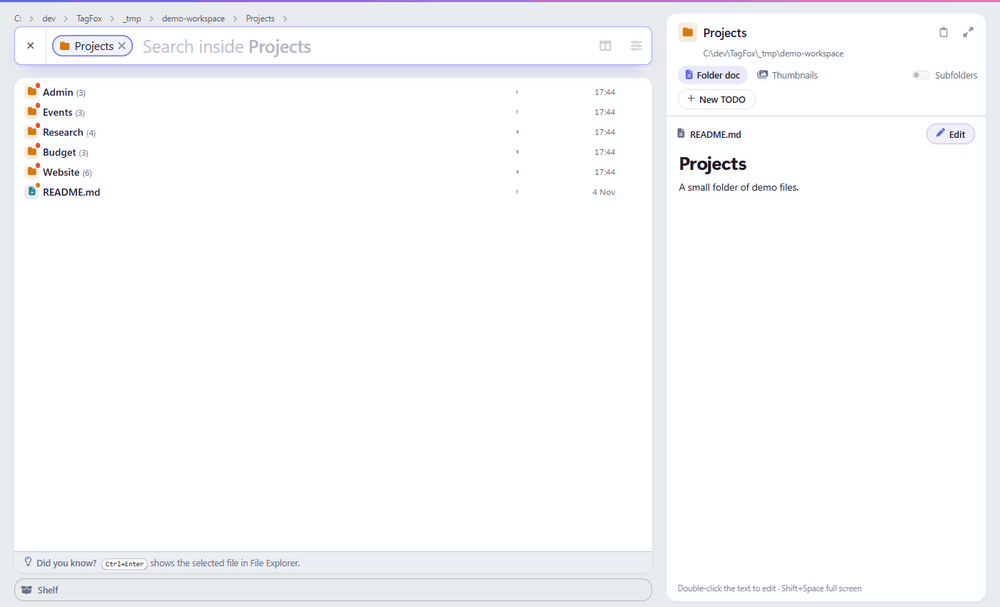
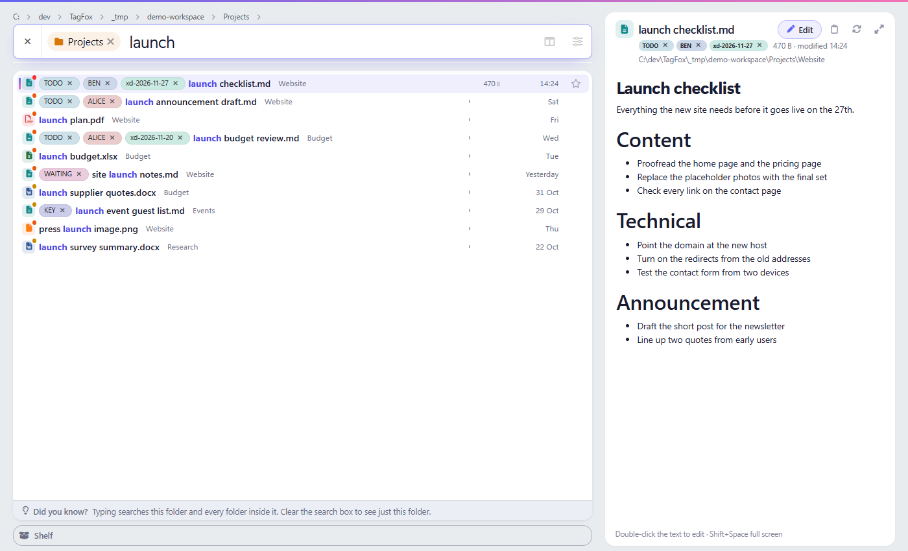

# Whippet

**A fast file finder for Windows.** Find any file on Windows as you type, then preview, tag and move it without leaving the keyboard.

Whippet runs on top of [Voidtools Everything](https://www.voidtools.com/), which keeps an index of every file name on the computer, so a search across millions of files answers while you are still typing. Around that search it does most of what File Explorer gets used for. It keeps tags and tasks in plain file names and markdown, which people, sync services and AI assistants can all read.



## What it does

- **Finds anything as you type**, on every drive Everything indexes.
  - Name matches come first, then files changed recently, starred and often used, with a boost for Windows' own Recent list.
  - `Ctrl`+`Alt`+`Space` brings Whippet up from any program with the search ready; `Ctrl`+`Shift`+`Space` shows everything changed in the last hour.
  - Narrow by folder, by file type (`.md`), by date (`Ctrl`+`R` steps from the last hour to the last year), by tag or by deadline; `-word` leaves a word out.
  - Save a search and run it again with `Alt`+`1` to `9`.
- **Shows a file without opening it.** Images, PDFs, Word, Excel, PowerPoint, markdown, text, audio and video preview in a side panel. Markdown and text files can be edited there, and each folder can show and edit its own readme.
- **Manages files.** Copy, cut and paste, to and from File Explorer and screenshots included; drag and drop; rename; bulk rename with wildcards; new folders; delete to the Recycle Bin, or for good with `Shift`+`Del`. The keys are the ones Explorer and Everything already use.
  - The Shelf gathers files from several folders while you find the one they belong in.
  - With another program's Open or Save dialog in front, the hotkey raises Whippet, and the file you pick goes into that dialog.
- **Tags and tracks work in the file name.** `Report xkTODO.docx` is tagged TODO, and typing `/todo` lists everything tagged TODO. The tags travel with the file into Explorer, Google Drive, zip files and git, without a database.
  - Tasks carry a status, an owner, a deadline (`xd-2026-07-15`) and a hide-until date (`xh-2026-09-01`), with filters for overdue, due today and due this week.
  - `Alt`+`Shift`+`N`, from any program, writes a TODO note as a markdown file.
- **Works with markdown and AI assistants.** `Ctrl`+`O` opens a markdown file in Obsidian when one of your vaults holds it. Because tags and tasks are plain names and markdown, an AI assistant working in the same folders can read and change them as easily as you can.
- **Runs from the keyboard.** `/` lists every command, `?` every key, and `F1` opens the guide.

## For everyday users

### What it needs

- Windows 10 or 11.
- [Voidtools Everything](https://www.voidtools.com/) 1.5 (in beta) with its HTTP Server plugin and HTTP server turned on. Whippet relies on Everything 1.5's `sort-mix:` search; Everything 1.4 is not supported.

### Install

1. **Install Everything 1.5** from the [Everything 1.5 page](https://www.voidtools.com/everything-1.5/), then add the Everything HTTP Server plugin from [voidtools' plugins page](https://www.voidtools.com/support/everything/plugins/). Let Everything finish its first index.
2. **Turn on the HTTP server** in Everything under **Tools, Options, HTTP Server**. Leave the address and port as they are.
3. **Install Whippet**, either way:
   - Download a `Whippet Setup` installer from the [Releases page](https://github.com/stevepowell99/whippet-files/releases) and run it. The installer is not code-signed, so Windows SmartScreen may warn you the first time; choose **More info, Run anyway**.
   - Or run it from source: install [Node.js](https://nodejs.org/), then `git clone https://github.com/stevepowell99/whippet-files`, `npm install` and `npm start` in that folder.

Open Whippet. If it cannot search through Everything, a setup card takes the place of the list. It works out which step you are on (Everything not installed, not running, only version 1.4, no HTTP Server plugin, or the HTTP server switched off), shows that one step with a button, and checks again by itself until Everything answers, when the card goes. When the HTTP server is on at a port other than the one in **Settings**, under **Connection to Everything Search**, Whippet sets that address to the port Everything's settings name. The card only reads Everything's settings and never changes them.

Some buttons appear only on a machine set up for them: opening markdown in the [gmist](https://mist.broad-smoke-cc64.workers.dev) editor needs a gmist checkout beside Whippet, **Print to PDF** needs a JobCat checkout with its `make_pdf.py`, and Google Drive sign-in needs a Google OAuth client file (see "Google Drive setup" below). Without them, those buttons are not shown.

Owner tags (`xp` plus a name, such as `xpSAM`) are the names you set in **Settings**, under **Owner tags**. There are none until you add some.

### Licence

MIT; see [`LICENSE`](LICENSE).

### Support

I built Whippet for my own work and use it every day. I read every issue, but I cannot promise fixes or support.

### First things to try

- **Set a search scope (recommended on a new PC).** In **Settings**, set one **search scope folder**, for example your profile or a projects root. Everything then only returns paths under that root.
- **Pick a current folder** from the breadcrumb. Search, paste and new files use the current folder.
- **Narrow the list** from the `/` list or the options panel: folders only, files only, or this folder only.
- **Tag a file.** Select a row, press `Ctrl`+`T`, and add a tag like `draft` or `2026`. The file is renamed on disk straight away.
- **Press `F1` or `Ctrl`+`/`** any time for the full in-app guide.

## Features



- **Keyboard first.** Navigate, tag, rename, bulk-edit and search without the mouse. Press `F1` for the shortcut table.
- **Filename tags.** Add, remove and filter by `xktag` labels stored in the filename. No database and no hidden metadata, so tags work everywhere the file goes.
- **Narrowing.** From the `/` list and the options panel: this folder only, folders only or files only, and what changed in the last hour, day or week. `Ctrl`+`R` steps through the hour, day, week, month, year and any time.
- **Fast previews.** Images, PDFs, Word, Excel, PowerPoint, text, JSON, markdown and more in the Viewer panel. For a folder it shows a folder readme you can edit in place.
- **Runner layout.** The window is one large search box over a ranked list, with the Viewer on the right third: arrows to move, right and left to go into a folder and back up, `/` for commands and tag filters, `Ctrl`+`D` to star, `Ctrl`+`T` to tag. Name matches rank above path matches, then recent, starred and often-used items.
- **The toggle shortcut selects the search text.** Raising Whippet with the global toggle key (set in Settings) puts the cursor in the search box with its text selected, so typing replaces it and an arrow key steps out of it. Alt-tab and a click into the window leave the cursor where it was.
- **Hide the window's title bar.** A Settings box, off by default, applied on the next start. Windows then draws only the minimise, maximise and close buttons, over the top right of the page, and you drag the window by its top strip. Double-clicking the strip maximises and restores.
- **Stars.** `Ctrl`+`D` stars a file or folder, which then ranks near the top of every search that finds it. To star the folder you are in, press `Ctrl`+`D` with no row selected, click the star among the folder chip's buttons, or type `/star`. `Ctrl`+`Shift`+`1` to `9` opens the first nine in the order they were starred: a folder becomes the current folder and a file opens.
- **Saved searches.** `/` then **Save this search** keeps the folder, the text and the filters. Each saved search is a `/` command of its own, and `Alt`+`1` to `9` runs the first nine.
- **The Shelf.** A staging strip under the results, one line high while empty. Drag files onto it from several folders, go elsewhere, then drag them onto a folder row or into the list. A drag moves and `Shift` copies, both onto the Shelf and off it. An item taken off with its × goes to the Recycle Bin. A clipboard for files that does not empty when you move.
- **Bulk rename.** Check several files, press `Ctrl`+`H`, and use wildcards on the last path segment with a live preview.
- **Open and Save dialogs.** With another app's Open or Save dialog in front, the toggle shortcut raises Whippet with a strip saying where the next pick goes. Enter sends the selected row to the dialog: in an Open dialog a file opens and a folder is shown; a Save dialog gets the folder, keeps its file name and leaves Save to you.
- **New TODO.** Create a small markdown file tagged `xkTODO` through the Quick TODO box: the Viewer's **New TODO** puts it in the folder on screen, and the `/` command **New TODO in this folder** in the current folder.
- **Folder docs.** The Viewer loads the first of `-readme.md`, `readme.md`, `claude.md`, `agents.md`, `about.md`, `index.md` and similar, so each folder can describe itself.
- **Paste from Explorer and screenshots.** Paste copied files into the current folder, or paste a screenshot to save `Clipboard image.png` there.
- **Mixed local and Google Docs.** Local Office files preview inline, older `.doc` files as their text. A Google Workspace shortcut (`.gdoc`, `.gsheet`, `.gslides`) is resolved from the shortcut or the Drive stream, including streamed (on-demand) files. The Viewer shows the PDF Google makes of it, fetched with the sign-in of Whippet's Google window, so open one there once to sign in. **Edit** opens it in that window.
- **Doc windows say which document they hold.** A gmist or Google Workspace window is titled with the file it was opened from, and shows that name in its own toolbar too. Minimise it and it becomes a small bar at the bottom of the desktop; Windows draws no text there, so the icon carries two letters from the name instead (`alpha report.docx` becomes AL). Where two open documents would claim the same pair, the second takes another, so README.md, readme notes.md and reference sheet.md show as RE, RN and RS. Each gets a colour of its own, fixed by its letters, so you can pick a window out by colour without reading it.
- **Google Drive shortcut folders.** Shared-folder shortcuts under `.shortcut-targets-by-id` are resolved to their real names in the breadcrumb and Name column, cached across restarts.
- **Open in gmist.** A markdown file (`.md`/`.qmd`) gets a row button for the [gmist](https://mist.broad-smoke-cc64.workers.dev) web editor, and you choose local or online per click. The pen icon opens the file in a local gmist straight from disk by its path (any file on any drive, in or out of Google Drive), in a Whippet window rather than the browser, starting `npm run dev:local` first if it is not already running, which takes about a minute the first time. The cloud icon opens the deployed editor in your browser using the file's Drive id (Google Drive files only). Both show on a Drive file. Online, auth is your signed-in gmist session; local gmist needs no sign-in.
- **Open in Obsidian.** A `.md` file inside one of your Obsidian vaults gets a gem button on its row, and the same entry in its `⋯` menu, which opens it in Obsidian; `Ctrl+O` does the same for the selected row. Whippet reads the vault list from Obsidian's own settings, so a newly added vault is picked up the next time the window gets focus. Files outside every vault, and inside a vault's hidden folders such as `.obsidian`, get neither, because Obsidian cannot open them.

## For developers

Whippet is an [Electron](https://www.electronjs.org/) desktop app. It talks only to the local Everything HTTP server and the local filesystem; there is no backend. The code keeps the app's earlier name, TagFox, in folder names, settings files and identifiers.

### Run from source

You still need Everything 1.5 with its HTTP server running (see the install steps above); the setup card walks you through it.

```bash
npm install
npm start
```

`npm start` runs `prestart`, which syncs vendor assets and rebuilds the help file before launching Electron.

### Build an installer

```bash
npm run dist
```

This runs electron-builder via `scripts/run-dist.js`. The installer is written **outside the repo** to `%LOCALAPPDATA%\TagFox-dist\` (not `dist/`, to avoid "app.asar in use" failures when an editor watches the tree). The newest `.exe` is then copied to the Drive folder `Causal Map\TagFox download\` (hello@ Drive) as `Whippet Setup <version>.exe`. Any older installer there (`Whippet Setup *.exe`, or `TagFox Setup *.exe` from before the rename) is removed, because stale copies are the main cause of "I installed it but it is the wrong version"; every build stays in `%LOCALAPPDATA%\TagFox-dist\`. The Drive folder is the distribution channel. Anyone with its link can view and download from it, so it holds the installer alone. Its link stays the same from one release to the next. The build is not code-signed, so SmartScreen warns recipients ("More info", then "Run anyway").

Release steps: bump `version` in `package.json`, then run `npm run dist`. The running build's version shows in the **Help** modal header (stamped by `build-help.js` from `package.json`), so anyone can read off which build they have.

The build bundles `google-oauth-client.json` (it is in the `build.files` allowlist) so distributed installers get the Google features, not just local `npm start` runs. The file must therefore be present in the app root at build time. A desktop OAuth client secret is not truly confidential (Google treats desktop clients as unable to keep one; the protection is the user's own sign-in and consent), so shipping it inside the exe is acceptable. It stays gitignored, so it lives only on the build machine, back it up with the other project secrets.

### Autostart, restart and the dev reloader

Steve runs Whippet with `npm start`, never the packaged app, so `npm run dist` exists only to hand someone else a build. A second running instance is another `npm start`, which loses the global hotkeys and the Chromium disk cache to the first (harmless startup errors: "already in use", "Unable to move the cache").

**Autostart** is a scheduled task per machine, `TagFoxAutostart`. `scripts/autostart.ps1` starts the Everything *user* instance (the service runs as SYSTEM and does not host the HTTP server, so the user instance is the one Whippet needs) and then `npm start`, waiting for the HTTP port read from the newest `Plugins*.ini` in `%APPDATA%\Everything` (`Plugins-1.5a.ini` for the alpha, `Plugins.ini` for the beta). It is idempotent, so its triggers can be generous: logon, session unlock and resume from sleep. Install or remove it with `pwsh scripts/install-autostart.ps1 [-Uninstall]`; no elevation needed. The task is not carried by git, so a fresh machine needs the installer run once, which `machine-parity.ps1 -Fix` does. It logs to `%LOCALAPPDATA%\TagFox\autostart.log`, and `scripts/start.js` adds a line there for every Electron exit (code, signal, minutes up), so a Whippet that vanished says whether it quit (code 0), was killed or crashed; there is no crash reporter, so no dump is ever written. An autostarted Whippet does not show a console, so stop it and run `npm start` by hand when you want the log live.

**Restart.** An edit to `main.js` never restarts Whippet; a Restart button shows in the search box instead (September 2026). The reloader used to `app.relaunch()` on every main-process change, which starts the new process outside the terminal, so an agent editing `main.js` killed Steve's `npm start` window and left a Whippet he could not see the console of. Main snapshots the mtime of every main-process module and both preload scripts at startup, and `tagfox-runtime-info` reports what has changed since; the renderer polls it every 30s and on focus and shows `btnRestartTagFox`. `npm start` is `scripts/start.js`, which runs Electron and starts it again when it exits with code 75. Every restart goes through `restartTagFoxProcess()` in main: the Restart button (`tagfox-restart`), Ctrl+F5 and the View menu's restart. It exits with 75 under the wrapper, so Whippet stays in the same terminal, and falls back to `app.relaunch` outside it. Settings opens with a **Running now** block naming this Whippet (start time, PID, whether its code is current) and whichever gmist holds 5173, classified from the runner above the listener (`describeLocalGmistHolder`: `dev-local.mjs --built` is `preview:local`). Guarded by `test/restart-in-terminal.cjs`.

Main believes it is under the wrapper only when its parent process is the wrapper (`START_WRAPPER_EXIT_CODE`, October 2026). The wrapper passes its code and its own PID in the environment, and main deletes both at startup. Environment variables outlive the wrapper: before this, a Whippet that Ctrl+F5 had relaunched outside the wrapper inherited `TAGFOX_START_WRAPPER`, so its next Restart exited with 75 and nothing was left to start it again. That is the likeliest account of Whippet vanishing on 23 October 2026, taking the global hotkey with it, minutes after a merge changed `main.js` and so showed the Restart button. The mechanism was reproduced in a throwaway instance, and is guarded by the no-wrapper case in `test/restart-in-terminal.cjs`, which fails on the old code.

**The dev reloader** (`startDevReloader` in `main.js`, `npm start` only) reloads Whippet's own pages when a renderer file changes, and reloads nothing once main-process or preload code has changed since start: then the Restart button shows, and a later renderer edit waits for it too. A reload over stale main code runs new renderer code against the old main process; on 9 November 2026 that left the window drawing nothing for 100 minutes, its hotkey and `/quit` dead, until the process was killed. It watches only the app's own files, the root entries of `build.files` in `package.json`, polling one stat a second each. A whole-tree watcher (`electron-reloader`, until November 2026) cost 10% of a core in main with polling on, and reloaded the window for an edit to any file in the repo, documentation included. Guarded by `test/dev-reloader.cjs`, which runs a copy of the app from a temporary folder, so it never edits files the running Whippet watches.

### Speed: priority and the perf log

**The renderer is never left at Chromium's background priority** (`disable-renderer-backgrounding` in `main.js`, August 2026). Chromium demotes a window's renderer to background mode whenever that window is hidden *or merely covered by another window*, which on Windows is `PROCESS_MODE_BACKGROUND_BEGIN`: Idle priority class, lowest I/O and memory priority, working set trimmed. Measured on STEVE-DELL: both Whippet renderers read `PriorityClass=Idle` for as long as the window was covered, while every other app on the machine stayed normal, and a Ctrl+Space raise then took 3-7s to first paint against ~50ms warm. That is the wrong policy for an app whose entire job is to appear instantly and take a keystroke, so the switch is set before `app.whenReady`, with `backgroundThrottling: false` on the window for the same reason (a hidden window's timers otherwise drop to 1Hz and then 1/min, so the first tick after a raise can be a second late). The cost is about 100MB kept resident while Whippet is off screen. Autostart is what made this bite: Whippet sits covered for days instead of being started when wanted. The main process, which routes every click to the page, raises itself to Normal at startup for the same reason (September 2026): Windows passes a launcher's BelowNormal on to its children, the autostart task used Task Scheduler's default priority of 7 (BelowNormal), and an `app.relaunch` inherits whatever the old process had. The task registers at 4, and `machine-parity.ps1` warns on one that does not. Both halves were needed, measured from the perf log: raises slower than 1s to paint went on after the renderer switch (up to 11s on 28 September 2026), and none of the 179 raises logged from the main-process change on 29 September to 26 October took longer than 789ms.

**`%TEMP%\tagfox-mainperf.log` is the one perf log, and both processes write to it.** Main logs `raise show=… to-paint=… away=…` per raise (with per-process working set and CPU across the raise, so a slow one says whether it was paging or work), `eventloop-lag`, `ipc <channel>` over 500ms, `ipc-sync <channel>` over 100ms (a sync channel blocks the renderer for its whole duration), and `everything-search` over 800ms. The renderer sends its own jank through `window.tagBrowser.perfLog` (`longtask`, `lag`, `vis=`, `key … to-paint=`), rate-capped in main at 60 lines a minute. Thresholds are set so an ordinary session writes nothing, so any line in that file is a real stall.

The page's own failures go there too (`watchPageHealth`, 25 October 2026): `page loaded` per load, `page failed-load`, `page preload-error`, `page renderer-gone` (and a crashed page is loaded again a second later, at most once a minute), `page unresponsive`, and console errors as `page error …`, ten a minute at most. A raise that has not painted 2s after the shortcut logs `raise no-paint` and asks for a new frame (`invalidate`); if the page answers and still has not painted 4s after that, it is reloaded. That guards the blank window Steve saw three times on 25 October 2026, each after a reload while Whippet was hidden, with none of the lines above logged; the guard is not yet proven against it, since a test window is never shown. The reload has to wait: one made inside the `render-process-gone` event never loaded. Guarded by `test/page-health.cjs`, which crashes the renderer with CDP `Page.crash`. A test instance (`TAGFOX_TEST_HIDDEN`) writes to `tagfox-mainperf-test.log` instead, because test runs type and search far harder than Steve does and once made up most of the main log.

### Tests

```bash
npm test
```

This runs the search, results and refresh regression suite. The tests launch the real app under the Chrome
DevTools Protocol and drive it through a hidden `#tagfoxtest` hook (inert in normal runs), so they exercise
the actual `renderer.js`. Everything must be running, the same as for the app. Full detail, including the
invariants checked and how to add a test, is in [`test/README.md`](test/README.md).

### Project layout

| File | Role |
|------|------|
| `main.js` | Electron main process: window, menus, IPC, filesystem and shell operations, Google OAuth |
| `preload.js` | Context bridge between renderer and main |
| `renderer.js` | The UI: search, results, tags, Viewer, Shelf, favourites, keyboard handling |
| `index.html`, `styles.css` | Markup and styling (Bootstrap 5 plus custom CSS) |
| `tags.js` | Tag parsing and the `xktag1 xktag2` filename grammar |
| `preview-text-helpers.js` | Text and markdown preview helpers |
| `did-you-know-tips.js` | Rotating tips on Runner's status line |
| `help.md`, `help.html` | In-app help source and generated output |
| `icons/` | The app icon: `whippet.svg`, and the `.ico` and 256 px PNG that `python scripts/make-icon.py` renders from it. The window and the installer use the `.ico`; the top strip's mark is the same head, inline in `index.html` |
| `scripts/build-help.js` | Builds `help.html` from `help.md` and its tab markers |
| `scripts/sync-vendor-assets.js` | Copies Bootstrap, Font Awesome, CodeMirror and other vendor files into `vendor/` |
| `scripts/run-dist.js` | Wraps the electron-builder distribution build |
| `file-dialog-handoff.js` | Reads and fills another app's Open or Save dialog through user32 (koffi) |
| `everything-setup.js` | First-run setup: finds Everything and reads its settings, read only (see "The setup card") |
| `web-editor-toolbar.html`, `web-editor-toolbar-preload.js` | Toolbar of the gmist and Google Workspace doc windows |
| `scripts/start.js` | `npm start`: runs Electron and starts it again on exit code 75 |
| `scripts/autostart.ps1`, `scripts/install-autostart.ps1` | The per-machine `TagFoxAutostart` task |
| `test/` | Automated search, results and refresh regression tests (see [`test/README.md`](test/README.md)) |

### How search works

Everything's HTTP API returns all folders before all files for a given sort. With **Max results** capped, a folder-heavy scope can fill a page with folders and show no files. Everything 1.5 adds a `sort-mix:` prefix that interleaves files and folders in true sort order, and Whippet appends it when **Hide files** is off (see `runSearch()` in `renderer.js`). This is why 1.5 is required. Reference: the [Everything forum thread](https://www.voidtools.com/forum/viewtopic.php?t=8994).

**Term order is most of what a query costs.** Everything answers one HTTP query at a time (five sent together took as long as five in a row), and for each item it checks the query's terms left to right, stopping at the first that fails. So a term that rules out most items cheaply goes first: a folder path or a `filelist:` before the words, plain text before a regex. Measured on 2.4 million items in October 2026, with identical rows either way: a tag filter alone 5.6s as a regex and 17ms behind its token as plain text; Runner's Temp query 300-500ms with the folder after the words and 75-115ms before them; the starred-paths `filelist:` 0.5-1s last and 3-10ms first.

Active tag filters are sent to Everything as a regex clause behind the tag token as plain text (`appendTagFiltersToEverythingQuery`, which adds the deadline filter's terms the same way), so matches exist before results load. **Hide special** and **Hide ~** are client-side filters in `listRowsForUi()`; the Everything query is unchanged, so paging still counts raw hits per page. So are the hide-until drop and the task-copy drop (`applyTaskCopyFilter`), which leaves out a tagged file in a `_tmp`, `archive` or `_archive` folder or a linked git worktree below the folder being browsed, as the hub's session-start scan does (`bin\surface-tasks.ps1`; the two lists change together). On 9 November 2026 it took a machine-wide `xkTODO` search from 846 rows to 406. The worktree roots come from the Everything keepalive, whose query lists every file named `.git` (19 on this machine, 2-4ms warm); main reads each and counts it a linked worktree when it points into `.git\worktrees\` (`linked-worktrees`). Guarded by `test/task-copies.cjs`.

**Recency means a file's own modified time**, so a recency window excludes folders (`file:`) unless Folders only is on (October 2026). The window is `dm:>=…` in the Everything query, but Windows bumps a folder's modified time when a child is created, deleted or renamed and never when one is edited, so folder hits made the filter look as if it followed creation: measured on STEVE-DELL, 1,876 of the last hour's 10,186 hits were such folders. `appendRecencyToEverythingQuery` is the one place recency is applied; there is no client-side recency filter.

### The setup card

When a search cannot reach Everything, `#everythingSetupCard` takes the place of the list (`renderer.js`, "Setup card"; `everything-setup.js` and the `everything-setup-detect` handler in `main.js`). It shows the first step not yet done: Everything not installed, only 1.4 installed, not running, no HTTP Server plugin, the HTTP server off, or on but not answering. Main reads and never writes: running processes (user sessions only; the Everything service runs in session 0), the uninstall registry entries, `Program Files\Everything*`, and Everything's settings. The one thing it does for the user is start the Everything program it found (`everything-setup-start`, which takes no path from the page).

- **Where Everything 1.5 keeps the HTTP server's settings** (read on 9 November 2026, and in [voidtools' guide](https://www.voidtools.com/forum/viewtopic.php?t=17663)): `%APPDATA%\Everything\Plugins.ini` for the beta, `Plugins-1.5a.ini` for the alpha (a portable copy keeps it beside the exe), section `[http_server64.dll]`, keys `enabled`, `port` and `bindings`. The beta installs to `C:\Program Files\Everything` with `Plugins\http_server64.dll`; the alpha used `Everything 1.5a`. The x64 plugin is `http_server64.dll` and other builds may be named otherwise, so any `http_server*.dll` counts, and the newest `Plugins*.ini` with such a section wins. Whippet's default address has no port, which is port 80, the HTTP server's own default.
- **Cost.** The probe is the Settings badge's (`probeEverythingOnce`, a one-result `sort-mix:` query through `everythingSearchRequest` in main) and runs every 2 seconds while the card shows. The detection, which starts PowerShell, runs at most every 6 seconds and on window focus. Nothing runs while connected: a search that fails starts the loop and a connection ends it.
- **1.4 or 1.5.** `sort-mix:` on its own matches every item in 1.5 (`totalResults` in the millions) and nothing in 1.4, which reads it as text. A probe that answers with zero results is 1.4 or a 1.5 still building its index, so the installed exe's file version decides, and a 1.5 shows no card.
- **Wrong port.** When the settings name a port other than Whippet's address and Everything answers there, the address is set to it. A refused sign-in counts as an answer.
- **Tests.** `test/everything-setup.cjs` names a fake machine in a JSON file (`TAGFOX_TEST_EVERYTHING_SOURCE`, read only under `TAGFOX_TEST_HIDDEN`) and drives every state without touching the real Everything.

### Runner layout

Runner is the renderer's only layout. `applyRunnerAtStartup` puts `body.tagfox-runner` on the page, whose CSS block restyles the shared markup, and the shared functions (`runSearch`, `sortLastRowsForDisplay`, `renderTableImpl`, the key handler) run without a layout test. Its search state is kept under `LS.runnerState`, written by `saveSettings` whenever a setting changes and applied at every start. Every key the window handles is an entry in `RUNNER_KEYS`, from which Help's key list is drawn: an entry runs while the focus is in another text field only with `fields`, and from an open menu only with `menus`.

- **What Classic left.** Runner has been the only layout since 24 October 2026, and Classic's own code is gone. Runner's state is renderer variables: `currentFolderPath`, `searchOpts`, `recencyMode`, `viewShowSubfolders` and `viewContent`. What Classic built and Runner still uses is shared code: the breadcrumb, the tag filter and editor, the results table, the Viewer, the stars, history and undo. Saved searches Classic stored still run, so `savedSearchCore` reads their fields. The base CSS rules under Runner's block stay where Runner overrides them (Steve, 26 October 2026): proving one dead means reaching every state it applies in and comparing every element's box and computed style. For the result rows that took longer than it was worth; two rules a first pass had called dead were live.
- **Keys follow the analogues people already know** (Steve, 26 October 2026). What is intuitive differs between contexts, so Steve does not want one key per action: where Everything, Explorer, a browser or an ordinary Windows app each suggest a key for the same action, Whippet answers to all of them (F3, Ctrl+F and Alt+D; Tab, Ctrl+↓ and Alt+↓; ← and Alt+↑; ? and Ctrl+/). Everything's and Explorer's keys are always among them: Ctrl+B, Ctrl+I and Ctrl+U for the match options, Alt+P for the Viewer, Ctrl+Enter, Alt+Enter, F2, Ctrl+Shift+N. Otherwise the ordinary Windows meaning holds: Ctrl+S saves the search, Ctrl+N makes a new TODO, Ctrl+W hides Whippet, Ctrl+Z undoes. A key that stands for a `/` command names it with `cmd`, which puts the key beside that command in the `/` list and the options panel. `test/runner-key-actions.cjs` drives them.
- **Stars are the favourites list**, so favourites hold files as well as folders; `path-kinds` in main tells them apart, which is how Ctrl+Shift+1..9 (`openFavouritePath`) knows to open a file and go into a folder (`test/runner-stars.cjs`).
- **Ranking.** Every weight is in `RUNNER_RANK` (`renderer.js`). `rankRowsForRunner` sorts first by how many query words the name contains, then by a score made of the match kind, recency, star and use counts. Use counts are the existing `fileFocusStats` and `folderFocusStats`, a boost and never a filter. So is Windows' Recent list (`windowsRecent`, decaying over `windowsRecentDays` from the shortcut's time), which `refreshRunnerWindowsRecent` asks main for at most once a minute and on focus. Paths under an `AppData` or `ProgramData` folder (`rankedDownFolders`) or with a `~` segment (Word's `~$` lock files, `~folders`) lose a fixed amount (`rankedDown`, `tilde`) rather than being hidden; the folder penalty is not taken inside that folder or when the query names it. Every Runner query leaves `AppData\Local\Temp` out, and in the smart order one more query fetches the newest `tempFetch` matches in the user's own Temp folder, which take the AppData penalty; mixed into the main query, Temp filled most of the `fetchCap` rows for a common word and pushed real matches out before ranking. **Hide temp files** drops that query. The `~` penalty is not taken when the whole name was typed, extension included (`runnerNameMatch` scores `keys.kdbx` as exact for that query), when the query contains a `~`, or inside a `~folder`; without the whole-name exception an xk note that only mentions `keys.kdbx` outranks the file itself.
  - **Settings › Ranking scales the weights.** One slider per influence (`RUNNER_RANK_KNOBS`: name match, recency, star, Whippet use, Windows' Recent list and the two penalties) multiplies its `RUNNER_RANK` weights. The middle is the weight as set; each step either side is ×√2 or ÷√2, up to ×4 at the right end; the far left is off. `runnerRankWeights()` applies them at each re-rank, and moving one re-ranks the rows already listed without a new search. Positions are kept in `LS.runnerRankKnobs`; Reset forgets them. The `/` command **Settings: Ranking** opens Settings at the section. The word-count tier still comes first, so the sliders order rows within it.
- **Extra queries.** Everything returns rows in its own sort order, so a name match far down a large result set would never be seen. When Match path is on, a name-only query (`nopath:`) runs alongside the main one, and every starred, used or Windows-recent path that could match is fetched by exact path in one more query, a `filelist:` placed ahead of the rest of the query; the rows are merged before ranking. The main query is sent first, so Everything, which answers in arrival order, returns it first: a new list (scope or query changed) paints the main rows straight away; the merged list replaces them when the extra queries are in. That early paint selects the top row without recording the list (`selectRowAfterSearch` with `early`), so the merged list selects its own top row unless the selection was moved in between. With the box empty inside a folder, the selection is the folder itself rather than a row (`folderItselfSelectable`, `selectFolderItself`): no row is selected, the box's folder chip is lit (`tagfox-runner-scope-chip--selected`), the Viewer shows the folder because `propsTargetPath` falls back to it, and row actions find nothing to act on, so Del in an empty box can never reach the folder you are in. The copies are the exception: Ctrl+Shift+C and Ctrl+C take the folder (`copyTargetPaths`). ↓ selects the first row and ↑ from it comes back; ← still selects the folder you came up from; Ctrl+Enter and Alt+Enter act on the folder, and Enter with a file dialog waiting sends it the folder. Enter in that gap waits for the merged list rather than opening the early top row (`runnerActivateSelection`). An auto-refresh tick never paints early, or its list would shrink and grow back every few seconds. When the hits exceed what was ranked, a muted note in the box says so (`renderRunnerRankNote`: "300 of 1.9M ranked", the full sentence in its tooltip).
- **Status line and tips.** Runner's filters are chips (`RUNNER_FILTER_CHIPS`, which also covers the deadline range and shown hide-until files, set by the `/` Due commands, and **Starred only**, which puts a `filelist:` of the stars in front of the query in `everythingSearchTextForUi`, and **This folder only**, which keeps a search that would look below the folder to its own contents) and its partial ranking is the note in the box, so `renderTableImpl` writes no hits line in Runner. The status bar (`#tagfoxNavbarStatus`), which holds the tip mount (`#navbarDidYouKnow`), is moved into the results column at startup (`placeStatusLine`), where CSS floats it over the foot of the list, just above the Shelf: the column is a grid in Runner, and the line shares the list's cell, pinned to its bottom, so the list runs down to the Shelf and the line takes no height of its own. The list's scroll area leaves room under its last row to scroll clear of the line, and the line lets clicks through to the rows while it shows only a tip. With no message the line shows the rotating "Did you know?" tip, muted: a new tip every four minutes, faded after one. A message (an error, an action's result, the F5 report) shows instead, as a box with an accent edge, for five seconds, longer while the pointer is on it (`flashRunnerStatus`, called by `setStatusMain`). The tips are in `did-you-know-tips.js`; `test/runner-status.cjs` checks that every key they name is in Runner's key table and every `/` command they name finds its command. Routine progress ("Searching…") passes `{ progress: true }`, which neither brings the bar up nor replaces a message the bar is still showing: an action's result starts a search, so its "Searching…" would otherwise be all the bar said.
- **Rows and orders.** Each row is one grid line: name, folder, size, modified time and star. The size is a bar on a fixed log scale from 1 KB (empty) to 10 GB (full), each seventh of the bar ten times the size before it (`runnerSizeBarFraction`), so a bar means the same size in every list; it is muted, and in the ink colour from 1 GB. On the row under the pointer and the selected row the figure takes the bar's place, at most three figures and a fainter unit (`runnerSizeParts`: "14 MB", "1.4 MB", "335 KB"). The cell is blank where Everything gives no size. Each row is its own grid, so the size and the date have fixed widths to stay in line. A cell has a tooltip only where it says more than the cell itself: the name on disk where tags were taken out of the name shown, and the full modified time. `RUNNER_SORTS` lists the orders: the smart ranking, and plain sorts by date, name, and size largest or smallest first, each a `/` command. `runnerSortColumnFor` gives the column Everything is asked to sort by, and `sortRowsForDisplay` sorts in the same order. The sort is a chip rather than part of a search, so Alt+Left and Alt+Right step through searches and leave it as it is.
- **Render window.** Runner draws `RUNNER_RENDER_PAGE` rows and grows the window as you scroll or arrow down, because the first layout of a results row costs about 1.6ms.
- **Tags.** Runner uses the shared tag filter and tag editor; nothing about tags is on screen until it is used. `RUNNER_COMMANDS` carries two filter commands per `TAG_VOCAB` word, `tag-todo` ("Tagged TODO") and `not-todo` ("Not tagged TODO"), which switch the filter through `toggleTagFilterInclude` and `toggleTagFilterExclude`, so the filter reaches Everything as the same regex clause and shows as the `tags` chip, wanted tags first. The options panel draws the include commands as a row of small buttons and leaves the excludes out (`runnerPanelCommands`): a right-click on a button runs its exclude. An excluded button reads `¬TODO`. With the box empty, only a wanted tag turns on subfolders, since a tag left out names nothing to look for. `Ctrl`+`T` (`runnerEditTags`) opens `openTagModal` or `openTagModalBulk` on the checked rows, else the selected one. Closing the editor puts the focus back in the box. Guarded by `test/runner-tags.cjs`.
- **Saved searches.** `LS.favSearches`, the list Classic saved, so its entries carry on. The / list and the options panel are `runnerCommands()`: `RUNNER_COMMANDS`, the Settings drawer's commands, then "Save this search" (`save-search`, which reads "Forget this saved search" while the search on screen is one of them) and one `saved-search-N` per entry, built on each call. `Alt`+`1`…`9` runs entry N (`runSavedSearch`). An entry keeps what `savedSearchCore` reads: the folder, the text, wanted and not-wanted tags with AND or OR, Folders or Files only, recency and the match and Show options. One saved in Runner also carries `runnerFilters` (the sort, This folder only, Starred only, Word starts only, Hide temp files, the deadline range and hidden-until), and a Classic entry gets each one's default. Of a Classic entry Runner leaves out the view (smart, tree or flat), Subfolders, the column sort, the Advanced panel and the search scope ceiling. Two entries are the same search when `savedSearchKey` matches, which compares the folder by its normalised path. A new entry is named after its text, or after its folder when there is none. Guarded by `test/runner-saved-searches.cjs`.
- **Settings as commands.** `runnerSettingsCommands()` reads the Settings drawer's markup on each call: every section heading becomes "Settings: <heading>", which opens the drawer at that section (`openSettingsSection`); every checkbox with a label becomes a switch named "<section>: <label>"; every option of a list becomes a choice that sets it. So a section or control added to the drawer is listed without being added anywhere else, and one the drawer hides (`d-none`) is left out. A text field is reached through its section. Guarded by `test/runner-settings-commands.cjs`, which counts the drawer's sections against the commands.
- **Breadcrumb.** Inside a folder its path is one line of small muted names above the box. It is `#breadcrumbBar`, restyled in Runner's CSS block: no tray, pill fills, icons or folder buttons, and each name's ▾ (the folders inside it) drawn as a faint › separator that turns down when open. The line never wraps: `fitRunnerBreadcrumb` hides leading names behind "…" (the whole path in its tooltip) until the line fits, always keeping the current folder's name. A `ResizeObserver` refits it when the room changes. The row has `contain: inline-size`, because names that never shrink would otherwise widen the page rather than overflow the line. A click on a name, or on a folder in a ▾ menu, goes through `goToBreadcrumbFolder`, which in Runner navigates as Left does: the box is cleared and the folder on the way back is selected.
- **An empty list says why.** One muted line where the rows would be (`renderRunnerEmptyNote`, called at the end of `renderTableImpl`) names the folder, the text and every filter chip that narrowed the list: the chips come from `RUNNER_FILTER_CHIPS`, whose `narrows: false` marks the ones that cannot empty a list (the sort, showing system files, showing hidden-until files). Inside a folder it adds "Enter: search everywhere"; Enter in the box with an empty list then drops the folder and keeps the text (`runnerSearchEverywhereWhenEmpty`). The line waits until no search is pending or running, so it never flashes up while a word is typed or between a list's early paint and its merged list. Guarded by `test/runner-empty-list.cjs`.
- **A path in the box.** Runner has no address bar, so a drive or UNC path in the box (surrounding quotes taken off, as Explorer's "Copy as path" adds them) goes there: a folder opens; a file's folder opens with the file selected. A paste acts at once; a typed path waits for Enter, so it is searched for as it is typed. `runnerGoToPathInBox` asks main's `path-kinds` whether the path is a folder, a file or nothing. Anything that does not exist stays an ordinary search. A folder lists only its newest `fetchCap` rows, so when the file is not among them its name goes in the box and the search finds it. Guarded by `test/runner-go-to-path.cjs`.
- **Folder chip.** The current folder is also a chip at the start of the box (`renderRunnerScopeChip`). `renderScopeBreadcrumb` moves the folder buttons (`#tagfoxScopeBarRowActions`: star, Explorer, copy, tags, terminal, quoted path, more) into it, shown while the chip is hovered.
- **Shelf.** `#appShelf`, laid flat under the list by Runner's CSS block, which sizes it: one line of hint text while empty, chips up to `max-height` and then a scroll. A chip's × shows on hover. The × and the clear button recycle (`recycleListBatched` in `main.js`), because a drop onto the Shelf moves the original there. Guarded by `test/runner-shelf.cjs`.
- **Viewer.** `#propsAside` is a card on Runner's canvas: Runner's CSS block gives it the surface colour, a radius and a margin, and the `.tagfox-viewer-*` classes style its parts. Its header is the only header: the type tile, the name (which takes the spare width), a save state, the labelled action (`setViewerEditButton`: Edit, then Save and Cancel for a folder doc or Done for a file) and icon buttons. Under it one meta line carries the tags, size and time (`setViewerMetaLine`) and then the parent folder, which copies the full path on a click (`setRunnerViewerPath`). A folder has a tab row, **Folder doc | Thumbnails**, a **Subfolders** switch and **New TODO**, which opens the Quick TODO box aimed at that folder (`showQuickTodoPop(folder)`). A folder without a doc shows an empty state with the name field and **Write it**; `syncFolderDocChrome` moves the name field into the bar while that editor is open. Mode blocks carry no headings of their own. A kind Whippet cannot show says so, by extension, with Open and Show in folder (`showPropsPlaceholder`), and a muted foot line says what can be done in the current mode (`syncPropsFootHint`). The side pane loads a PDF with `PDF_VIEW_PARAMS_PANE` (no plugin toolbar, fit to width). The Viewer button at the right of the search box (`btnRunnerViewer`), Alt+P and the `/` command **The Viewer** all hide and show it through `runnerToggleViewer` (`LS.runnerViewerOff`); the button stops being faint while the Viewer is hidden. The Viewer sits at a third of the window until its divider (`#splitProps`) is dragged; the drag stores Runner's own width (`LS.runnerViewerWidthPx`, which adds `tagfox-runner-viewer-sized` so the inline width applies) and a double-click forgets it. The divider takes no width: its grab band is the gap between the two cards, so the spacing is the same with or without it (`test/runner-viewer-split.cjs`). Guarded by `test/viewer-runner.cjs`.

### The window and the global shortcuts

`toggleMainWindowFromGlobalShortcut` (`main.js`) shows and focuses the window, then sends `tagfox-hotkey-raised`; the preload passes it to `onHotkeyRaised` (`renderer.js`), which selects the query. The window `focus` event fires for every kind of focus, alt-tab and a click into the window included, and those keep the caret where it was, so the message is what marks a raise. It and the `focus` event reach the renderer in either order. When the document already has focus as the message arrives, `onHotkeyRaised` selects at once. Otherwise it leaves a one-shot flag (`hotkeyRaiseSelectUntil`, 1.5 seconds) that the `focus` handler reads when the event fires, not in its animation frame, which a slow raise can run seconds later. Ctrl+Shift+Space and Quick TODO raise through other messages and need nothing, since the first opens a tab with an empty query. Guarded by `test/hotkey-raise-select.cjs`.

- **The window's × hides Whippet** (25 October 2026). Closing used to quit, which took the global shortcut with it, so Steve's next Ctrl+Alt+Space did nothing. The main window's `close` handler in `createWindow` turns a close into a hide unless `appQuitting` is set, which `before-quit` (File → **Quit Whippet**, labelled because the role reads "Exit" on Windows, and the `/` command **Quit Whippet** through `tagfox-quit`) and Windows' `query-session-end` set. `app.exit` (Restart) never raises the event. Guarded by `test/close-hides.cjs`, which posts the real `WM_CLOSE`: the renderer's `window.close()` skips the close event, so a test using it would pass on the old code.
- **A raise does not show an overlay.** A keyboard overlay offering the open tabs plus saved searches and folders was removed in August 2026, because Steve found it more trouble than it was worth.
- **Ctrl+Shift+Space** raises Whippet on the last hour's changes anywhere. It is fixed (`RECENT_CHANGES_ACCEL` in `main.js`), not in Settings like the toggle and Quick TODO. Main raises the window and sends `tagfox-open-recent-changes`, and the renderer's `openRecentChanges()` resets the search in place to Runner's own defaults (`runnerResetAllFilters`): no query text, no scope folder, no tags, every other filter off, the last hour. It is OS-wide, so there is no in-app key handler for it, and a failed registration (another app holds the combo) is only a startup `console.warn`. `test/recent-changes.cjs` covers the renderer half; the registration was checked once by sending a real keypress at a test instance.
- **Every global-shortcut raise minimises the doc windows first** (`minimiseWebEditorWindows`, September 2026). An owned window always sits above its owner, so no amount of `show()`/`focus()` on the main window uncovers results hidden under a gmist or Workspace window. The toggle shortcut's raise, Ctrl+Shift+Space and the Quick TODO shortcut all go through it. Hiding Whippet leaves the doc windows alone.

### Sending a pick to a file dialog

The toggle shortcut pressed from another app's Open or Save dialog sends the next pick to that dialog (prototype, 25 October 2026). `CLAUDE.md` holds the four rules about what may be written and pressed. `toggleMainWindowFromGlobalShortcut` reads the foreground window before it raises Whippet (`file-dialog-handoff.js`: user32 through koffi, about 5µs a call, against a second a call for PowerShell and 13ms for a warm one). A standard file dialog (class `#32770`) with its file-name box becomes `fileDialogTarget`; the window handle stays in main, and the renderer is told the app, the title and the kind (`tagfox-file-dialog-target`), which shows `#fileDialogBar` above the box. While that is set, `keyboardActivateSelection` sends the row instead of opening it, so Enter, a double-click and Ctrl+1…9 all send. Ctrl+Enter sends the folder Whippet is showing and Esc stops; those three keys are `first: true` entries in `RUNNER_KEYS`, tried before the rest. Any hide of the window clears the target. When the window in front is not such a dialog, the toggle raises Whippet as usual. Pressing an Open dialog's button opens a file and navigates to a folder.

The file-name box is a visible `Edit` (control id 1148 in an Open dialog, 1001 in Save As) inside a `ComboBox`, and the address bar's `ToolbarWindow32` under `Breadcrumb Parent` reads "Address: <folder>" (measured on Windows 11). Guarded by `test/file-dialog-handoff.cjs` (the renderer half, hidden) and `test/manual-file-dialog.cjs`, which opens real Open and Save As dialogs on screen and so is run by hand only, after asking Steve (passed 25 October 2026). Not yet checked: a packaged build, where koffi's `.node` must come out of the asar (electron-builder unpacks `.node` files by default), and other apps' dialogs (Chrome's upload, Office).

### Hidden title bar

A window's frame is fixed when it is created, so `main.js` reads `tagfox-window-chrome.json` (userData) in `createWindow` and, when `hideTitleBar` is set, creates the window with `titleBarStyle: 'hidden'` and a `titleBarOverlay`. The Settings box writes the file and shows **Restart now** when the saved choice differs from the running window.

- **The page owns its drag handle.** `body.tagfox-frameless` starts the page below a fixed strip the height of the title bar, `body::after`, which is the drag region. It is `::after` because the body is `.app-shell`, whose `::before` is the 3px gradient.
- **Sizes come from `env(titlebar-area-*)`**, which is in CSS pixels and so follows the page zoom; a constant in pixels would be wrong at any zoom but 100%. The same values keep the expanded Viewer below the strip, since its header buttons otherwise sit under the window buttons.
- **The window buttons take the page's colours.** `syncTitleBarOverlayColors` reads the background under the top right corner and the body text colour after a theme or layout change, and main keeps them in the same file so the next start opens in them.
- Guarded by `test/window-chrome.cjs`, which seeds the setting into a fresh profile.

### Search concurrency

The results area is one pane, and it owns the canonical DOM ids (`tbody`, `resultsTable`, and so on), so
`renderTable()` (which writes to `#tbody`) always targets it. A search, F5, auto-refresh or CRUD refresh
all act on that pane and nothing else. This is why the results code is simple to reason about: there is never
a second pane rendering in the background. The old two-pane split kept two panes rendered at once, and every
historical bug (searches rendering into the hidden pane, load-more rows lost on a background refresh, a
copy/delete in one pane bleeding into the other) came from a background flow re-rendering the *other* pane.

There is one search state: the live controls, `lastRows` and the paging context (`resultsPagingCtx`).

One search flow runs at a time. Every call to `runSearchNow` waits on `searchMutex`, so a fresh event-loop
task (the debounced search, F5, a disk-mutation retry) that fires while another flow is mid-await waits its
turn rather than running concurrently. `runSearch` is called only from there, inside the mutex.

In Runner, a search that a newer one overtakes sends nothing more. Every top-level request takes a number
(`searchRequestSeq`); one that is still waiting for the mutex when a newer request arrives steps aside and
waits for the newest to finish, and the running search checks `runnerSearchSuperseded()` before painting and
before each of its extra queries, which go out one at a time after the main query. Everything answers one query
at a time, so otherwise each stale keystroke's four or five queries would hold up the newest one's.
`runner-query-order.cjs` counts the queries sent to prove it.

`loadMoreResults()` grows `lastRows`. A refresh comes back with page one, so an auto-refresh tick would throw
the extra pages away; `autoRefreshTickWouldDisturb()` skips the tick once the list has grown past its first
page. `loadmore-regression.cjs` checks that a tick on the first page runs and that one after two load-mores
leaves the grown rows on screen, and every test's structural check compares the rows on screen with the rows
the list should draw.

### Auto-refresh and explicit refresh

**Auto-refresh is on by default at 5 seconds, and a tick repaints only on a real change** (September 2026). The timer always re-ran the search, but every tick used to rebuild the whole table whether or not the rows had moved, which dropped the scroll position, disposed and remade every tooltip and shifted the row under the pointer. So it sat at Off and the list went stale whenever files changed outside Whippet. A tick sets `quietAutoRefreshRender`, and `renderTableImpl` compares `resultsTableRenderSignature()` (display paths in order, each with its modified time and size, so an edit in place counts) against the last one rendered and returns without touching the DOM when they match; a repaint that does happen restores `scrollTop`. `autoRefreshTickWouldDisturb()` skips the tick outright while the pointer has moved, pressed or wheeled over the list in the last two seconds (`RESULTS_POINTER_SETTLE_MS`; a pointer merely resting there does not block it), a drag is live, or the list has been grown past its first page, since a refresh comes back with page one and a tick after load-more would throw the extra pages away. That last test is `singleOffset > pageSize`, never `> 0`: `singleOffset` starts at the first page's own row count, and `> 0` silently stopped the timer for every non-empty search while the "nothing was rebuilt" assertion went on passing. A tick also writes nothing to the status line (`runSearch` skips its "Searching…" for a tick), because a tick's "Searching…" used to stay there for good. None of this touches F5 or the Refresh command, which always repaint and always report. An old Off is carried to 5s once, via `LS.autoRefreshDefaultMoved`. Guarded by `test/quiet-refresh.cjs`, whose positive control (a new file must still get through) is the half that matters, since a tick that never ran looks exactly like a tick that found nothing.

**An explicit refresh proves it ran, through one choke point, `refreshResultsFromUi()`.** F5 arrives by two routes (main's `before-input-event` → `tagfox-plain-f5-refresh`, and the renderer's own keydown) and only while the page holds OS keyboard focus, which Steve loses often enough to report refreshes that never happened. So Refresh is also a click away, in the options panel (and in the `/` list), since a click always lands, and every route goes through the one function. Runner does not carry a refresh button of its own: Steve chose the panel entry and the 5-second auto-refresh over one (25 October 2026). It reports `Refreshed hh:mm:ss — N row(s), unchanged` (or `+3 new, -1 gone`), because a refresh that finds nothing new is otherwise indistinguishable on screen from a keypress that never arrived, which is what "F5 sometimes does not refresh" turned out to describe. Guarded by `test/refresh-visible.cjs`, which clicks the panel's entry with the mouse.

### Refresh after CRUD (delete fast-path)

A delete only removes rows. `removeGonePathsFromUiNow()` tombstones the deleted paths and repaints once, so
the rows vanish immediately. Because no new content can appear, `refreshAfterDiskMutation()` detects a pure
delete (`isPureTombstoneMutation`, payload `trashed` with no `destFolder`/`copied`/`moved`) and skips the
immediate re-query, scheduling a single quiet reconcile (~1s) to retire the tombstones once the Everything
index settles. Moves and pastes bring in new rows and keep the prompt refresh plus the 350ms/1200ms catch-up
retries. All delete call sites (bulk bar, Delete key, context menu) tag the payload with `trashed: true` so
the fast-path fires regardless of which refresh call wins the coalesce. `delete-hides-row.cjs` checks that a deleted row stays hidden through a refresh.

The recycle itself (`main.js`) was the bigger cost for cloud paths (Google Drive, OneDrive), which take the
PowerShell route because `shell.trashItem` rejects many of those paths. The old script spawned one PowerShell
per file and compiled C# at runtime each time (about 365ms of compile plus cold start, so 1-4s for a few
files). It now loads `Microsoft.VisualBasic` from the GAC (no compile) and recycles the whole batch in one
spawn, returning per-path results as JSON lines. Local paths still use the native `shell.trashItem` (no
spawn). Measured: 3 files about 4.0s to 1.7s, 5 files about 6.8s to 1.4s.

### Viewer internals

The Viewer's layout is under "Runner layout" above; this is what sits behind it.

- **The markdown write is armed by the editor, never by the preview** (September 2026). Selecting a `.md` or `.txt` file loads its text into the same buffer the editor uses. That buffer's write used to be armed by the load, and it flushes on blur, on the next selection and on a panel refresh, so Whippet saved a buffer nobody had typed into over whatever had written the file since. On a file Steve co-edits with an agent that reverted his work to the state it had when he last looked at it, seconds or hours later, with nothing on screen to say so; it cost him about 30% of his time for eight weeks and was blamed on five other things first. The three rules that hold now are in `CLAUDE.md`. Guarded by `test/md-preview-no-write.cjs`.
- **A splitter drag runs under a shield** (August 2026). The Viewer holds iframes and the PDF preview runs in its own process, so a drag that crossed one stopped delivering mouse moves to the page: the divider froze and then jumped when the pointer came back, which is what "the divider has a mind of its own" turned out to be. Every splitter drag puts a fixed transparent `.tagfox-split-drag-shield` over the window (`addSplitDragShield`), which keeps every hit test in this document; the Viewer splitter also drags on pointer events with `setPointerCapture`, so a release outside the window ends the drag instead of leaving it live, and it starts on the left button only. Width is clamped by `maxPropsPaneWidthPx()` to what the results and Viewer panes share minus `RESULTS_PANE_MIN_PX`, read from those two elements rather than from a parent that also holds the splitter. An old fixed 1600px ceiling let CSS `max-width: 90vw` stop the panel while the drag counted on past it, so the pointer had to be dragged all the way back before anything moved, and the results pane could be squeezed to a sliver. The divider's hover lights a 4px bar in its 20px grab band; the bar used to scale 2.3x, so the target moved as the pointer arrived and shrank again whenever a drag ran ahead of it. Guarded by `test/splitter-drag.cjs`.
- **PDF view parameters.** The expanded Viewer (Shift+Space) is 90vw x 100vh. Chromium's PDF plugin reads its view parameters from the URL fragment, and only at load, so `setPdfFrameSrc`/`syncPdfViewParams` (renderer) remember the blob URL and rebuild the fragment (`PDF_VIEW_PARAMS_PANE`, `PDF_VIEW_PARAMS_THEATER`) whenever the Viewer enters or leaves the expanded state. `toolbar=0` is the only thing that closes the plugin's thumbnail sidebar, measured against the Electron PDF viewer at 1728px (September 2026): `pagemode=none` left the thumbnails where they were, while `toolbar=0` removed the sidebar and the toolbar together and still honoured `zoom=150`. The side pane is for a glance, so it drops the toolbar too and asks for `view=FitH` (Steve, 25 October 2026). Measured in a 438px pane, the plugin's zoom read 0.524 with that fragment and with none, which is an A4 page fitted to the pane; the fragment states the fit rather than relying on the default. The page counter, zoom buttons, print and download go with the toolbar; Ctrl+wheel still zooms and the header still carries Reload.
- **A Google shortcut's preview is the PDF Google exports** (`google-shortcut-pdf` in `main.js`, October 2026), fetched with the Workspace window's cookies. Whippet's OAuth scopes (`drive.file`, `drive.metadata.readonly`) cannot export a file Whippet did not create, and `drive.readonly` is a restricted scope, which would put Google's unverified-app screen in front of everyone given the installer; the Workspace window is where Steve signs in to Google anyway. A Doc, a Sheet and a deck each came back as a PDF in about a second (measured on STEVE-DELL). The shortcut's `email` goes in as `authuser`, since Google otherwise answers as the first account signed in. The PDF goes through the ordinary PDF pane, with the header's **Edit** opening the Workspace window. `test/viewer-google-doc.cjs` stands a local server in for Google.
- **A `.doc` is read in main by what it really is** (`read-doc-text`). Of 3,676 `.doc` files indexed on STEVE-DELL in October 2026, 1,941 were Word 97-2003 binary, 1,664 Word 2003 XML and 30 a `.docx` under the old name. Binary goes through `word-extractor` and XML through its `w:t` runs, both as text without formatting; a zip goes on to the renderer's `.docx` preview.
- **Header and folder doc.** A mode block's own actions sit in the header, `d-none` by default and toggled with their block (`btnPdfRefresh`, `btnMdFileRefresh`/`btnMdFileEdit` via `syncMdFileViewerButtons`). For a folder or a folder doc, `#propsNestedReadmeToggleWrap` holds the Folder doc | Thumbnails tabs, the Subfolders switch and New TODO. A found folder doc gets a bar naming it with Edit, which becomes Save beside Cancel while the editor is open; with none, `#readmeEmptyState` holds the name field (stem, extension, tags) beside Write it, and while the new doc is being written that field moves up into the bar, so there is one field in one of two slots. Starting a differently named second folder doc while a found one is displayed was dropped on purpose, since the Subfolders view reaches every doc. A text file's Edit becomes Done, and `#propsSaveState` reports what the last autosave did, from the write's own result.
- **New TODO is the Quick TODO box aimed at a folder** (October 2026). The folder view's New TODO, Ctrl+N and the `/` command "New TODO in this folder" call `showQuickTodoPop(folder)` with the folder on screen; the global shortcut, and Ctrl+N outside a folder, call it with none, so the file goes in the Quick TODO folder from Settings.

### Drag and drop

The default row and Shelf drag uses an in-page protocol (move or copy inside the app; hold `Shift` to copy). External apps need `Alt`+drag, or the Shelf **OS drag** arm, to receive native paths. Native drag blocks the UI thread, which is why the two paths are kept separate.

### Editing the help

The in-app help is generated from [`help.md`](help.md). Each tab is introduced by a single-line HTML comment whose body is `help:tab` plus JSON (`id`, `label`, one `"active":true`, optional `"format":"html"`). Edit `help.md`, then run:

```bash
npm run build:help
```

`npm start` and `npm run dist` rebuild the help for you. Notes for maintainers only live in the HTML comment at the top of `help.md`.

### Google Drive setup (optional)

**Create new Google Doc here** needs a single Google OAuth client. Add `google-oauth-client.json` in the app root with either:

- `{ "clientId": "...", "clientSecret": "...", "redirectUri": "http://127.0.0.1:53682/oauth2callback" }`
- or standard Google Desktop JSON (`installed.client_id`, `installed.client_secret`, `installed.redirect_uris`).

In the [Google Cloud Console](https://console.cloud.google.com/), under OAuth consent screen and Credentials, include the scopes `drive.metadata.readonly` and `drive.file`. On first use Whippet opens browser sign-in once and saves a single account token in the app userData folder. If you carried over a token from an older build, delete `tagfox-google-oauth-token.json` in app userData and sign in again so `drive.file` is granted.

The `google-oauth-client.json` file holds client credentials and is gitignored. Do not commit it. It is, however, bundled into the packaged installer (see "Build an installer" above) so distributed builds get Google features.

Because it is gitignored it does not travel with a clone, so a fresh machine has no Google features at all and every Drive-backed action fails with "Google Drive sign-in is needed first" while opening nothing. The copy to use is `Causal Map\mild-secrets\client_secret.json` on the shared Drive (a desktop client in the standard `installed` shape); copy it to the app root as `google-oauth-client.json` and sign in once. `machine-parity.ps1` checks for it under `oauth-client`, so a machine missing it says so rather than waiting to be discovered mid-task.

That is what happened on STEVE-DELL on 19 August 2026: the cloud pen said "Open in gmist online: Google Drive sign-in is needed first (Settings)" and never built a URL, which read as the online feature having broken. Mirrored Drive files carry no `:user.drive.id` stream either (checked with `Get-Item -Stream *`), so the API is the only route and there is no silent fallback. Two separate faults hid behind one symptom there: the missing client file, and the browser Whippet handed the finished link to (see "Which browser" below). The second only became visible once the first was fixed.

**Resolving a row's Drive file id.** `resolveGoogleDriveFileIdRobust` (`main.js`) escalates: the local `:user.drive.id` stream, else hunt the parent folder id via a sibling that carries one (`inferGoogleDriveFolderIdFromChildItems`) and look the file up scoped to that folder (collision-safe for repeated names), else a unique exact-name Drive-API match. The thin `resolveGoogleDriveFileIdForPath` is stream-only and returns nothing for a mirrored file whose stream is unreadable. The stream path needs no API; the fallbacks need Google sign-in (the `google-oauth-client.json` OAuth account, same as "Open in Google Workspace" and "Create Google Doc here").

The `:user.drive.id` read is synchronous and escalates to cmd and then PowerShell. Measured on STEVE-DELL, 19 August 2026: one escalation costs about 700ms, and the parent-folder inference ran it for every sibling, which froze the main process for 19 seconds on a single click (`eventloop-lag 19133ms` next to `ipc resolve-google-drive-file-id 21516ms` in the perf log) and made the cloud pen take 20s to open a tab. Mirror-mode Drive carries no such stream on any file, so every one of those spawns was always going to fail. The scan reads every sibling with the plain Node read only (`{ cheapOnly: true }`, 4ms for the whole folder) and pays the escalation on at most `ADS_ESCALATION_BUDGET` of them, then remembers a streamless folder for ten minutes so the next click skips even that.

### Open in gmist and Google Workspace (the row's pen buttons)

The results-row edit icon (pen, `btnGmist` in `renderer.js`) opens the row for editing, routed by file type:

- `.md`/`.qmd` → **gmist**, with a button per applicable mode so Steve picks local or online per click (chosen July 2026 over an automatic local-first default; he sometimes wants the deployed version):
  - a **local** pen (`fa-pen-to-square`) on every markdown row of a machine that has a gmist (see "Machine features" below), opening `http://localhost:5173/open?path=<absolute path>` in a Whippet child window (see "Doc windows" below): any file on any drive (C:, G:, H:), no Drive lookup, no sign-in, no name ambiguity, and it works for files not in Drive at all;
  - an **online** cloud (`fa-cloud`) when the file is under a Drive mount (`pathUnderGoogleDrive`), opening the deployed worker `https://mist.broad-smoke-cc64.workers.dev/open?file=<id>&p=<readable home-relative path>` (needs the file's Drive id, resolved from the local mirror).

  So a Drive markdown file shows both, and a file outside Drive shows only the local pen. They are separate actions (`openRowInLocalGmist` / `openRowInOnlineGmist`). gmist mints the room and owns both `/open` contracts (gmist's `CLAUDE.md`, local mode and the `GET /open` route); `&p=` is a legibility breadcrumb gmist ignores. Auth is the browser's gmist session (bypassed in local mode).
- Office and Google-native docs (`.docx`/`.xlsx`/`.pptx`/`.odt`/`.ods`/`.odp`/`.rtf`/`.csv` and `.gdoc`/`.gsheet`/`.gslides`) → **Open in Google Workspace** (`rowEligibleForWorkspaceEdit` → `openRowInGoogleWorkspace`). Google-native shortcuts reuse the shortcut resolver (`openFileDefaultOrGoogleWorkspace`, same as the row Open button and the Viewer); Office files resolve their Drive file id and open the matching Google editor (`docs.google.com/document|spreadsheets|presentation/d/<id>/edit`) in an in-app Workspace window. The resolver's fallbacks need Google sign-in; the stream path needs none.
- The row context menu's **Open in Google Workspace** is the same decision and the same action: the renderer passes `canOpenInGoogleWorkspace` (`rowEligibleForWorkspaceEdit`) to the menu and runs `openRowInGoogleWorkspace` on its answer, as with Obsidian. The list also holds `.md`/`.markdown`, which Docs edits in place, keeping the file as markdown (Google, October 2026), at the same `docs.google.com/document/d/<id>/edit` URL as `.docx`. On a `.md` row that is the menu entry only, since the row's pens stay gmist's; a `.markdown` row, which gmist does not open, gets the Workspace pen.

**Markdown opens in a local gmist by default (August 2026), not in the shell.** `.md`/`.qmd` route to `openRowInLocalGmist` from the one choke point every open path goes through (`openFileDefaultOrGoogleWorkspace`), so the row Open button, Enter and a double-click all land in gmist, starting it first if it is down. The way back to Obsidian or whatever holds the association is the row context menu, whose "Open" entry reads **"Open with default app"** for markdown (`isMarkdownFilePath` in `main.js`); that entry runs in main and never touches the renderer's routing. The Viewer's own inline markdown editor is unaffected.

**Copy gmist share link** (row context menu, 28 August 2026), for handing a file to a collaborator. A markdown row's `⋯` menu carries a submenu offering a suggest link or an edit link. Both open the file in the deployed gmist with `&share=<role>` appended. gmist then puts the resulting link on the clipboard once the room is up (its `ShareOnOpen`). The copying has to happen over there because the gmist session cookie lives in the browser, so Whippet cannot mint a room or read back its URL. Suggest is listed first, since a reviewer who cannot rewrite the file underneath you is the usual case. The entry shows for a markdown file in Google Drive: the renderer decides that with `pathUnderGoogleDrive`, the test behind the row's cloud pen, and passes it to the menu as `underGoogleDrive`.

**Open in Obsidian** (gem button and `⋯` menu entry, October 2026). `obsidian://open?path=<absolute path>` through `openUrlInSystemDefaultBrowser`, offered only for a `.md` file inside a registered vault, since Obsidian answers "Vault not found" for anything else. Main reads the vaults from `%APPDATA%\obsidian\obsidian.json` (`obsidian-vault-roots`); the renderer caches them, re-reads on every focus, and owns the membership test (`pathInObsidianVault`), passing `inObsidianVault` to the context menu so the button and the menu entry are one decision and one action (`openRowInObsidian`).

**Machine features** (`machineFeatures` in `main.js`, October 2026). A packaged Whippet handed to someone else usually lacks a gmist, JobCat and a Google OAuth client. There the local pen, the PDF button, Print to PDF, Copy gmist share link, Create new Google Doc here and Open in Google Workspace could only fail, each with a message about setup the recipient cannot do. Main answers `machine-features` with `{ gmist, makePdf, googleSignIn }`: `localGmistSource()` (a `mist` checkout; the one place that decides whether this machine has a gmist, which `startLocalGmist` uses too), `findMakePdfScript()`, and `readGoogleOAuthClientConfigSync()`. The renderer reads it at startup and on every focus (`refreshMachineFeatures`, `machineHas`) and counts everything as present until the first answer. Without a gmist, markdown opens in the default app without trying gmist or writing a status line. The gmist test is keyed on there being no gmist anywhere, never on gmist not running, because a pen that vanished whenever the dev server stopped read as a deleted feature (August 2026). `test/machine-features.cjs` runs the no-gmist case here with `TAGFOX_GMIST_FORCE_BUNDLED=1` and no bundle.

#### Starting local gmist

The local pen starts gmist when it is not running (`start-local-gmist`), rather than hiding itself. Until August 2026 the button appeared only while a probe said gmist was up, so a stopped dev server silently removed it, which reads as the feature having been deleted; that is exactly how it got reported. A click asks main to start gmist; main settles from the ports whether one is already up, and on a cold start runs gmist's start script and waits for `/go` to answer (up to 300s, `LOCAL_GMIST_START_TIMEOUT_MS`, because that start includes a build). Three things about the spawn are load-bearing, all measured 11 August 2026:

- **`shell: true` and NOT `detached`.** `detached: true` on Windows gives the child a new console, so the grandchildren that matter (npm → node → vite) write there instead of the inherited log handle, and the parent stops receiving `exit` at all: a failed start then looks exactly like a slow one. Non-detached still outlives Whippet, since Windows does not kill children when a parent exits; it dies only with the console Whippet was launched from.
- **Output goes to `%LOCALAPPDATA%\TagFox\gmist-local.log`**, and a failure reports the tail of it. The common failure is a stale localfs sidecar still holding 5199, which the start script explains in its own words and then exits 1; without the log that arrives as a bare timeout.
- **The repo is found, not hardcoded:** a `repoDir` in `tagfox-local-gmist.json` (userData), else a sibling `mist` checkout, else `C:\dev\mist`, and each candidate must actually carry a `preview:local` or `dev:local` script.

**What Whippet starts is `preview:local`, a production build, not the dev server (21 September 2026).** `localGmistStartScript()` prefers it and falls back to `dev:local` for an older checkout. This is not a preference about speed. React's dev build logs every commit and that logging deep-walks props; React Router hangs the real `window` off its router object, and `window[0]` is gmist's sandboxed deck iframe, which is cross-origin, so reading it throws inside a passive effect and takes React's work loop down. gmist then looks perfectly normal and is dead: every button silently does nothing, while links still work because they need no handler, which is how it was reported ("print and Online work, the rest do nothing"). It happens on any deck with the slide pane open, which is most of why markdown is opened from here at all. None of that code exists in a production build. The cost is the build on a cold start, hence the 300s budget; a server already holding 5173 is reused either way, so a `dev:local` Steve started himself still wins.

**Whether the ports are held settles "is gmist up", and no HTTP probe is allowed near that question (31 August 2026).** A probe that says "down" about a gmist that is up is the worst case. The start that follows dies on the sidecar port the running gmist already holds, so `dev:local exited straight away (code 1)` arrives on screen and reads as a broken feature. Steve hit that on 18 August and again on 31 August, both times on a gmist whose dev server and sidecar had been up for hours. The reason no timeout can be tuned to fix it: measured against a gmist up for three days, `HEAD /go` answered in 1.3s, 1.6s, 1.9s, 3.3s and 3.3s on one run, then 2.6s, 4.9s, 6.1s, 9.0s and 11.3s twenty minutes later, because the dev server re-evaluates the worker entry per request. The old budget was 600ms, so it called a healthy gmist down on nearly every click. A probe is a slow judgement about a slow server and can never be the guard. `portIsHeld()` is: it asks the OS to bind the port, which answers in microseconds and needs no subprocess. So `startLocalGmist` reads 5173 and 5199 first. **5173 held means gmist is there**, so return at once and let the window wait out however long the page takes. **5199 held with 5173 free** is two situations wearing one pair of ports, and only one of them is an error. `dev:local` brings the sidecar up first and vite several seconds later, so a click in that window sees exactly what an orphan looks like; on 3 September 2026 it told Steve to `taskkill` the gmist he was about to use, which had been up since 08:34. They are told apart by who owns the sidecar: `sidecarHasLiveGmistRunner()` asks whether the port holder's parent is a live `dev:local`. A live runner means gmist is starting, so wait for 5173 on the same budget a spawn of our own would get. No runner is the real orphan `dev:local` refuses on, reported with its PID rather than after a doomed spawn and a log tail. That check shells out to PowerShell, which is why it sits on the error path beside netstat and never on the common one. **Both free** means nothing is listening, so spawn without probing at all: an "up after all?" check there would time out on every cold start for an answer already known. Guarded by `test/gmist-start-guard.cjs`, which holds each port with a socket that accepts and never answers, the worst case for a probe and the easy case for this.

**Use `portIsHeld()` on any path a click waits for, and `listenersByPort()` only to name a culprit.** `netstat -ano` measured 2.2s on this machine, against 116ms for the whole IPC round trip once the bind check replaced it, so netstat belongs on error paths alone. Both look at `127.0.0.1` and `[::1]`, because the vite dev server binds `[::1]` only: a bind test against `127.0.0.1` alone would succeed and call the port free, and `netstat -p tcp` would list IPv4 only and miss the dev server entirely. `probeLocalGmistOnce` keeps the same pair for the same reason. Its one remaining job is the wait during a cold start, on a single generous budget (`LOCAL_GMIST_PROBE_PATIENT_MS`), where a server coming up has to be given time to answer.

**A failed start names what is holding the ports.** `localGmistPortHolderHint()` reads the listeners on 5173 and 5199 and appends `PID … / taskkill /PID … /F`, because gmist's own message says to stop the sidecar without saying which process that is. It shells `netstat -ano`, never `-p tcp`, which lists IPv4 only and would miss the `[::1]` dev server.

#### Doc windows

- **One child-window mechanism serves both editors** (`openWebEditorWindow`, August 2026). The framed window Google Docs use (a BrowserWindow holding a toolbar BrowserView over a content BrowserView, with remembered bounds) takes a kind from `WEB_EDITOR_KINDS` in `main.js`, which carries everything site-specific: the URL allowlist for loads and for the address bar, the session partition, the bounds file, and whether the Google-only "Expand" button shows. `googleWorkspace` is the Google editor; `gmistLocal` allows only the `localhost:5173` origin. The toolbar is `web-editor-toolbar.html` plus its preload, and its IPC channels are `webedit-toolbar-*`.
- **A minimised doc window parks inside Whippet, as a pill on the Shelf's row** (`parkWebEditorWindow`, 9 November 2026). A gmist or Workspace window is owned by the main window (`parent:`), so the shell gives it no taskbar button, and Windows would leave its caption stub along the bottom of the desktop, away from Whippet and over whatever sits there. So the window's `minimize` hides it instead, sets `webEditParked` (the one record of what is in the tray) and sends the tray to the main window (`tagfox-doc-tray`, drawn by `renderDocTray` into `#docTray`, the Shelf row's second grid column, which collapses while empty). A pill shows the window's two letters on its icon's ground and the name without its tags; a click restores the window (`unparkWebEditorWindow`) and its x closes it. A global-shortcut raise parks every visible doc window the same way, without the minimise animation. `test/manual-doc-tray.cjs`, by hand only.
- **The window icon carries two letters of the name** (23 August 2026), chosen while a minimised doc window was still a desktop stub that could show nothing else. It labels the window in alt-tab; the tray's pills repeat its letters and ground. Measured then on STEVE-DELL with four doc windows open: stubs sit in 160px slots along `y = workArea bottom`, and the themed stub draws **no caption text at all**, whatever `setTitle` says. (A `PrintWindow` capture is misleading here, because it renders the classic theme, which does draw about four characters. Capture the live screen instead.) So a window title alone leaves a row of identical Electron atoms, which is what Steve reported. `webEditorIconAbbrev` takes two characters from the filename and `applyWebEditorWindowIcon` has the window's own toolbar page rasterise them to a 16 and 32px PNG on a canvas, which becomes the window icon: the row then reads RE, AL, NO. Two is the measured ceiling. Three across, six stacked as two rows of three, and eight as two rows of four were each opened, minimised and captured at real size on 23 August 2026; Steve called the six-letter version invisible on his screen and it is. The square is 16px, so every extra character comes straight off the glyph size. Because two characters collide easily, the pair is chosen against the windows already open: the first two letters normally, else the first letter with the second word's initial, then with each later letter, then with a digit. README.md, readme notes.md and reference sheet.md open as RE, RN and RS. The ground colour is hashed from the pair as well (`webEditorIconHue`, ten hues at least 30 degrees apart), so a document keeps its colour between sessions and a row of pills separates by colour before anyone reads the letters. It steps to the next free hue on a clash, for the same reason the letters do. A raw hue from the hash was tried first and rejected: six test names gave three near-identical greens, because neighbouring hues in the yellows read as one colour at 16px. The canvas is in `web-editor-toolbar.html` because a BrowserView is the only text rasteriser here. The full name still goes on the window title and into the toolbar strip, for the restored window and for alt-tab.
- **The row's cloud pen opens online gmist in the default browser; local gmist's own Online (globe) button asks.** A child window is its own cookie jar, and local mode needs no sign-in, so embedding it costs nothing. The deployed worker signs in with Google OAuth, which Google may refuse inside an Electron view, and Steve's gmist session already lives in his browser. The globe is a `target="_blank"` link to the deployed origin, which Electron's default opens as a bare window in the local window's cookie jar: signed out, it looks like a different gmist. A `setWindowOpenHandler` on the `gmistLocal` content catches that origin and pops a menu (`offerOnlineGmistTarget`): a `gmistOnline` Whippet window with its own persistent session, or the browser. Every other new-window link from local gmist keeps Electron's default.
- **Local gmist's print button saves a real PDF beside the deck** (`printLocalGmistDeckToPdf`, September 2026). The same window-open handler catches `/slides/lf_…?print-pdf`, decodes the absolute path from the id (`lf_` + base64url, gmist's `app/lib/localfs-ids.ts`), loads the print view in a hidden window on the `gmistLocal` session, waits for `html[data-mist-ready]` and runs `printToPDF` with the settings the online server route uses (`preferCSSPageSize`, `printBackground`). Measured on the UNICEF deck: ready in 6s, the same 24 pages at the same size as the server's PDF, visually identical. The PDF goes beside the `.md`, an existing one is replaced only on a yes, and the result offers Open or Show in folder. In a browser, local gmist still falls back to the print dialog.

#### Which browser

**Ask the shell which browser, never work it out from the registry (19 August 2026).** `openUrlInSystemDefaultBrowser` used to read `UrlAssociations\https\UserChoice` and spawn that ProgId's command. On STEVE-DELL that key says `MSEdgeHTM` while Windows itself opens Chrome, so every gmist link Whippet opened landed in Edge, which holds no gmist session, and the page answered `{"error":"sign in required"}` while Steve rightly insisted Chrome was his default. Measured: `start https://…` launched Chrome, the key said Edge, and the ProgId command behind it is `msedge.exe`. A UserChoice key Windows has stopped honouring is not a default browser, so `shell.openExternal` (ShellExecuteEx, what Explorer calls) does the work, with `rundll32 url.dll,FileProtocolHandler` behind it. `cmd /c start` is not a fallback: it truncates a URL at the first `&`, measured as a probe arriving as `/probe?a=1` with two parameters lost, which would silently drop `&p=` from every gmist link. `test/manual-browser-open.cjs` re-measures the whole path; it opens a real tab, so it stays out of `npm test`.

### Print markdown to PDF (the row PDF icon)

Markdown rows carry a `fa-file-pdf` button beside the two gmist pens, and the row `⋯` actions menu carries the same thing as a **Print to PDF** submenu. Both write a sibling `<name>.pdf`.

- **The renderer is JobCat's `make_pdf.py`, run as a subprocess, so Whippet holds no PDF styling of its own.** JobCat's `README.md` is canonical for the flags and the profiles, so change the house PDF there. `main.js` runs the script with `cwd` set to the JobCat folder, because it resolves its logo (`img/…`) against the working folder, and passes absolute `--input`/`--output` through argv with no shell, so the spaces in a Drive path survive.
- **Three profiles, chosen per click: plain (`--type none`), Causal Map branded (`--type cm`), Steve Powell branded (`--type steve`).** A personal note and a client proposal want different branding, so the click opens a small native menu rather than assuming one, the same per-click choice the local and online gmist pens offer.
- **The JobCat folder and the Python interpreter are both resolved at run time.** JobCat: `jobcatDir` in `tagfox-make-pdf.json` (userData), else the Drive copy built from the home folder, else a sibling checkout or `C:\dev\JobCat`; each candidate must carry `make_pdf.py`. Python: a real `%LOCALAPPDATA%\Programs\Python\Python3*\python.exe` ahead of a bare `python`, which on Windows is often the WindowsApps stub that opens the Store and runs nothing.
- **An existing PDF of that name is never replaced without asking**, since a downloaded `report.pdf` often sits beside `report.md`. Main returns `{exists:true}` and the renderer confirms before a second call with `overwrite`.
- **A run reports a PDF only when the output is on disk and non-empty**, because `make_pdf.py` can print a traceback and still exit 0. Its output goes to `%LOCALAPPDATA%\TagFox\make-pdf.log` and a failure carries the tail of that log. A run takes about 7 seconds (Chromium launch), so the status line says it started and then names what it wrote.
- **`make_pdf.py` does not embed body images**, so a markdown file whose pictures matter still wants Quarto or the garden PDF route.

### Decided against

- **A general Drive sync-status badge.** Steve's Google Drives are mirrored, not streamed (hub `env-windows.md`), so a downloaded-versus-cloud-only badge would read "local" for everything and carry no signal, and there is no reliable API for live upload or sync state. The only place a marker would inform is shared or streamed content under `.shortcut-targets-by-id`, which `main.js` already detects; whether to add that narrow "shared (streamed)" marker is open.
