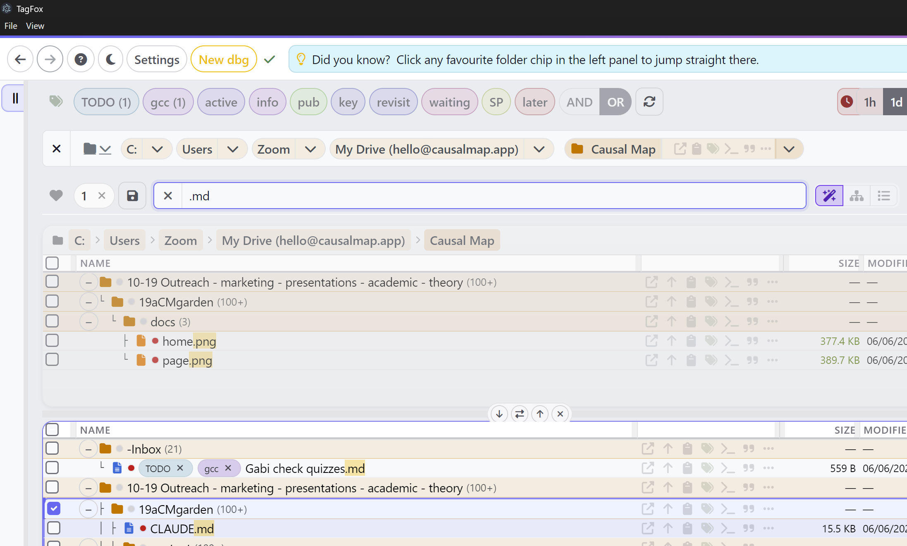

# TagFox

TagFox is a fast, keyboard-friendly file finder and tagger for Windows. It puts instant search, file previews and filename tags in one window, so you can find, preview and organise your files without opening File Explorer.

It runs on top of [Voidtools Everything](https://www.voidtools.com/), which indexes your whole drive and answers searches the moment you type.



## For everyday users

### What you get

- **Instant search** across your whole drive as you type.
- **Tags** you add right in the filename, like `Report xkdraft xkurgent.docx`. Click a tag to filter; the tags travel with the file into Explorer, Google Drive and zip files because they are part of the name.
- **Previews** of images, PDFs, Word, Excel, PowerPoint, markdown, text, audio and video, in a side panel.
- **Stars** on the files and folders you come back to, which rank near the top and open with a number key.

### Install in three steps

TagFox needs Everything running in the background. Everything is free.

1. **Install Everything 1.5a** from the [Everything 1.5a downloads](https://www.voidtools.com/everything-1.5a), then add the HTTP Server plugin: [x64 installer](https://www.voidtools.com/Everything-HTTP-Server-1.0.3.4.x64-Setup.exe) or [x86 installer](https://www.voidtools.com/Everything-HTTP-Server-1.0.3.4.x86-Setup.exe). Let Everything finish its first index.
2. **Turn on the HTTP server** in Everything under **Tools, Options, HTTP Server**. Keep the default address `127.0.0.1` and port `8080`.
3. **Install TagFox.** Download the latest `TagFox Setup` installer from the [Releases page](https://github.com/stevepowell99/TagFox/releases) and run it. TagFox is not code-signed, so Windows SmartScreen may warn you the first time; choose **More info, Run anyway**.

Open TagFox. In **Settings**, under **Connection to Everything Search**, the URL should already be `http://127.0.0.1:8080`. If results stay empty, Everything is probably not running.

TagFox relies on the `sort-mix:` feature, so Everything 1.5a is the supported version. Everything 1.4 may connect but is not supported.

### First things to try

- **Set a search scope (recommended on a new PC).** In **Settings**, set one **search scope folder**, for example your profile or a projects root. Everything then only returns paths under that root.
- **Pick a current folder** from the breadcrumb. Search, paste and new files use the current folder.
- **Switch views** with the buttons by the search box: subfolders on or off, files and folders or folders only.
- **Tag a file.** Select a row, press `Ctrl`+`T`, and add a tag like `draft` or `2026`. The file is renamed on disk straight away.
- **Press `F1` or `Ctrl`+`/`** any time for the full in-app guide.

If search feels slow, open **Advanced** and turn off **Folder-contents highlight** and **Hide special**.

## Features

- **Keyboard first.** Navigate, tag, rename, bulk-edit and search without the mouse. Press `F1` for the shortcut table.
- **Filename tags.** Add, remove and filter by `xktag` labels stored in the filename. No database and no hidden metadata, so tags work everywhere the file goes.
- **View switches.** Subfolders on or off, files and folders or folders only, combined freely. Recency buttons (1h, 1d, 1w, 1m, 1y) filter to what changed recently.
- **Fast previews.** Images, PDFs, Word, Excel, PowerPoint, text, JSON, markdown and more in the Viewer panel. For a folder it shows a folder readme you can edit in place.
- **Runner layout.** The window is one large search box over a ranked list, with the Viewer on the right third: arrows to move, right and left to go into a folder and back up, `/` for commands and tag filters, `Ctrl`+`D` to star, `Ctrl`+`T` to tag. Name matches rank above path matches, then recent, starred and often-used items. Runner is the only layout on screen; the Classic layout this list otherwise describes is hidden while its code is deleted in stages.
- **The toggle shortcut selects the search text.** Raising TagFox with the global toggle key (set in Settings) puts the cursor in the search box with its text selected, so typing replaces it and an arrow key steps out of it. Alt-tab and a click into the window leave the cursor where it was.
- **Hide the window's title bar.** A Settings box, off by default, applied on the next start. Windows then draws only the minimise, maximise and close buttons, over the top right of the page, and you drag the window by its top strip (Runner) or its header row (Classic). Double-clicking there maximises and restores as before.
- **Stars.** `Ctrl`+`D` stars a file or folder, which then ranks near the top of every search that finds it. `Ctrl`+`Shift`+`1` to `9` opens the first nine in the order they were starred: a folder becomes the current folder and a file opens.
- **Saved searches.** `/` then **Save this search** keeps the folder, the text and the filters. Each saved search is a `/` command of its own, and `Alt`+`1` to `9` runs the first nine.
- **The Shelf.** A staging strip under the results (beside them in Classic), one line high while empty. Drag files onto it from several folders, go elsewhere, then drag them onto a folder row or into the list. A drag moves and `Shift` copies, both onto the Shelf and off it. An item taken off with its × goes to the Recycle Bin. A clipboard for files that does not empty when you move.
- **Bulk rename.** Check several files, press `Ctrl`+`H`, and use wildcards on the last path segment with a live preview.
- **Open and Save dialogs.** With another app's Open or Save dialog in front, the toggle shortcut raises TagFox with a strip saying where the next pick goes. Enter sends the selected row to the dialog: in an Open dialog a file opens and a folder is shown; a Save dialog gets the folder, keeps its file name and leaves Save to you.
- **New TODO.** Create a small markdown file tagged `xkTODO` through the Quick TODO box: the Viewer's **New TODO** puts it in the folder on screen, and the `/` command **New TODO in this folder** in the current folder.
- **Folder docs.** The Viewer loads the first of `-readme.md`, `readme.md`, `claude.md`, `agents.md`, `about.md`, `index.md` and similar, so each folder can describe itself.
- **Paste from Explorer and screenshots.** Paste copied files into the current folder, or paste a screenshot to save `Clipboard image.png` there.
- **Mixed local and Google Docs.** Local Office files preview inline. Google Workspace shortcuts (`.gdoc`, `.gsheet`, `.gslides`) open in a popup, resolved from the shortcut or the Drive stream, including streamed (on-demand) files.
- **Doc windows say which document they hold.** A gmist or Google Workspace window is titled with the file it was opened from, and shows that name in its own toolbar too. Minimise it and it becomes a small bar at the bottom of the desktop; Windows draws no text there, so the icon carries two letters from the name instead (`alpha report.docx` becomes AL). Where two open documents would claim the same pair, the second takes another, so README.md, readme notes.md and reference sheet.md show as RE, RN and RS. Each gets a colour of its own, fixed by its letters, so you can pick a window out by colour without reading it.
- **Google Drive shortcut folders.** Shared-folder shortcuts under `.shortcut-targets-by-id` are resolved to their real names in the breadcrumb and Name column, cached across restarts.
- **Open in gmist.** A markdown file (`.md`/`.qmd`) gets a row button for the [gmist](https://mist.broad-smoke-cc64.workers.dev) web editor, and you choose local or online per click. The pen icon opens the file in a local gmist straight from disk by its path (any file on any drive, in or out of Google Drive), in a TagFox window rather than the browser, starting `npm run dev:local` first if it is not already running, which takes about a minute the first time. The cloud icon opens the deployed editor in your browser using the file's Drive id (Google Drive files only). Both show on a Drive file. Online, auth is your signed-in gmist session; local gmist needs no sign-in.
- **Open in Obsidian.** A `.md` file inside one of your Obsidian vaults gets a gem button on its row, and the same entry in its `⋯` menu, which opens it in Obsidian. TagFox reads the vault list from Obsidian's own settings, so a newly added vault is picked up the next time the window gets focus. Files outside every vault, and inside a vault's hidden folders such as `.obsidian`, get neither, because Obsidian cannot open them.

## For developers

TagFox is an [Electron](https://www.electronjs.org/) desktop app. It talks only to the local Everything HTTP server and the local filesystem; there is no backend.

### Run from source

You still need Everything 1.5a with its HTTP server running (see the install steps above).

```bash
npm install
npm start
```

`npm start` runs `prestart`, which syncs vendor assets and rebuilds the help file before launching Electron.

### Build an installer

```bash
npm run dist
```

This runs electron-builder via `scripts/run-dist.js`. The installer is written **outside the repo** to `%LOCALAPPDATA%\TagFox-dist\` (not `dist/`, to avoid "app.asar in use" failures when an editor watches the tree), and the newest `.exe` is then copied to the shared Drive folder `Causal Map\` as `TagFox Setup <version>.exe`. That Drive copy is the distribution channel for colleagues. The build is not code-signed, so SmartScreen may warn recipients.

Release steps: bump `version` in `package.json`, run `npm run dist`, then delete any older `TagFox Setup *.exe` from the Drive folder so only the current one remains (stale copies are the main cause of "I installed it but it is the wrong version"). The running build's version shows in the **Help** modal header (stamped by `build-help.js` from `package.json`), so anyone can read off which build they have.

The build bundles `google-oauth-client.json` (it is in the `build.files` allowlist) so distributed installers get the Google features, not just local `npm start` runs. The file must therefore be present in the app root at build time. A desktop OAuth client secret is not truly confidential (Google treats desktop clients as unable to keep one; the protection is the user's own sign-in and consent), so shipping it inside the exe is acceptable. It stays gitignored, so it lives only on the build machine, back it up with the other project secrets.

### Tests

```bash
npm test
```

This runs the search, results and refresh regression suite. The tests launch the real app under the Chrome
DevTools Protocol and drive it through a hidden `#tagfoxtest` hook (inert in normal runs), so they exercise
the actual `renderer.js`. Everything must be running, the same as for the app. Full detail, including the
invariants checked and how to add a test, is in [`test/README.md`](test/README.md).

### Project layout

| File | Role |
|------|------|
| `main.js` | Electron main process: window, menus, IPC, filesystem and shell operations, Google OAuth |
| `preload.js` | Context bridge between renderer and main |
| `renderer.js` | The UI: search, results, tags, Viewer, Shelf, favourites, keyboard handling |
| `index.html`, `styles.css` | Markup and styling (Bootstrap 5 plus custom CSS) |
| `tags.js` | Tag parsing and the `xktag1 xktag2` filename grammar |
| `preview-text-helpers.js` | Text and markdown preview helpers |
| `did-you-know-tips.js` | Rotating tips on Runner's status line |
| `help.md`, `help.html` | In-app help source and generated output |
| `scripts/build-help.js` | Builds `help.html` from `help.md` and its tab markers |
| `scripts/sync-vendor-assets.js` | Copies Bootstrap, Font Awesome, CodeMirror and other vendor files into `vendor/` |
| `scripts/run-dist.js` | Wraps the electron-builder distribution build |
| `test/` | Automated dual-pane / refresh regression tests (see [`test/README.md`](test/README.md)) |

### How search works

Everything's HTTP API returns all folders before all files for a given sort. With **Max results** capped, a folder-heavy scope can fill a page with folders and show no files. Everything 1.5a adds a `sort-mix:` prefix that interleaves files and folders in true sort order, and TagFox appends it when **Hide files** is off (see `runSearch()` in `renderer.js`). This is why 1.5a is required. Reference: the [Everything forum thread](https://www.voidtools.com/forum/viewtopic.php?t=8994).

**Term order is most of what a query costs.** Everything answers one HTTP query at a time (five sent together took as long as five in a row), and for each item it checks the query's terms left to right, stopping at the first that fails. So a term that rules out most items cheaply goes first: a folder path or a `filelist:` before the words, plain text before a regex. Measured on 2.4 million items in October 2026, with identical rows either way: a tag filter alone 5.6s as a regex and 17ms behind its token as plain text; Runner's Temp query 300-500ms with the folder after the words and 75-115ms before them; the starred-paths `filelist:` 0.5-1s last and 3-10ms first.

Active tag filters are sent to Everything as a regex clause behind the tag token as plain text (`appendTagFiltersToEverythingQuery`, which adds the deadline filter's terms the same way), so matches exist before results load. **Hide special** and **Hide ~** are client-side filters in `listRowsForUi()`; the Everything query is unchanged, so paging still counts raw hits per page.

### Runner layout

Runner is a layout of the same renderer. `applyRunnerAtStartup` puts `body.tagfox-runner` on the page, which hides the Classic markup in CSS, and the shared functions (`runSearch`, `sortLastRowsForDisplay`, `renderTableImpl`, the key handler) run Runner's way without a layout test. Its search state is kept under `LS.runnerState`, written by `saveSettings` whenever a setting changes and applied at every start. Every key the window handles is an entry in `RUNNER_KEYS`, from which Help's key list is drawn: an entry runs while the focus is in another text field only with `fields`, and from an open menu only with `menus`.

- **Ranking.** Every weight is in `RUNNER_RANK` (`renderer.js`). `rankRowsForRunner` sorts first by how many query words the name contains, then by a score made of the match kind, recency, star and use counts. Use counts are the existing `fileFocusStats` and `folderFocusStats`, a boost and never a filter. So is Windows' Recent list (`windowsRecent`, decaying over `windowsRecentDays` from the shortcut's time), which `refreshRunnerWindowsRecent` asks main for at most once a minute and on focus. Paths under an `AppData` or `ProgramData` folder (`rankedDownFolders`) or with a `~` segment (Word's `~$` lock files, `~folders`) lose a fixed amount (`rankedDown`, `tilde`) rather than being hidden; the folder penalty is not taken inside that folder or when the query names it. Every Runner query leaves `AppData\Local\Temp` out, and in the smart order one more query fetches the newest `tempFetch` matches in the user's own Temp folder, which take the AppData penalty; mixed into the main query, Temp filled most of the `fetchCap` rows for a common word and pushed real matches out before ranking. **Hide temp files** drops that query. The `~` penalty is not taken when the whole name was typed, extension included (`runnerNameMatch` scores `keys.kdbx` as exact for that query), when the query contains a `~`, or inside a `~folder`; without the whole-name exception an xk note that only mentions `keys.kdbx` outranks the file itself.
- **Extra queries.** Everything returns rows in its own sort order, so a name match far down a large result set would never be seen. When Match path is on, a name-only query (`nopath:`) runs alongside the main one, and every starred, used or Windows-recent path that could match is fetched by exact path in one more query, a `filelist:` placed ahead of the rest of the query; the rows are merged before ranking. The main query is sent first, so Everything, which answers in arrival order, returns it first: a new list (scope or query changed) paints the main rows straight away; the merged list replaces them when the extra queries are in. That early paint selects the top row without recording the list (`selectRowAfterSearch` with `early`), so the merged list selects its own top row unless the selection was moved in between. With the box empty inside a folder, the selection is the folder itself rather than a row (`folderItselfSelectable`, `selectFolderItself`): no row is selected, the box's folder chip is lit (`tagfox-runner-scope-chip--selected`), the Viewer shows the folder because `propsTargetPath` falls back to it, and row actions find nothing to act on, so Del in an empty box can never reach the folder you are in. ↓ selects the first row and ↑ from it comes back; ← still selects the folder you came up from; Ctrl+Enter and Alt+Enter act on the folder, and Enter with a file dialog waiting sends it the folder. Enter in that gap waits for the merged list rather than opening the early top row (`runnerActivateSelection`). An auto-refresh tick never paints early, or its list would shrink and grow back every few seconds. When the hits exceed what was ranked, a muted note in the box says so (`renderRunnerRankNote`: "300 of 1.9M ranked", the full sentence in its tooltip).
- **Status line and tips.** Runner's filters are chips (`RUNNER_FILTER_CHIPS`, which also covers the deadline range and shown hide-until files, set by the `/` Due commands, and **Starred only**, which puts a `filelist:` of the stars in front of the query in `everythingSearchTextForUi`, and **This folder only**, which keeps a search that would look below the folder to its own contents) and its partial ranking is the note in the box, so `renderTableImpl` writes no hits line in Runner. The status bar from Classic's footer, which holds the tip mount (`#navbarDidYouKnow`), is moved into the results column at startup (`placeStatusLine`), where CSS floats it over the foot of the list, just above the Shelf: the column is a grid in Runner, and the line shares the list's cell, pinned to its bottom, so the list runs down to the Shelf and the line takes no height of its own. The list's scroll area leaves room under its last row to scroll clear of the line, and the line lets clicks through to the rows while it shows only a tip. With no message the line shows the rotating "Did you know?" tip, muted, on Classic's timing: a new tip every four minutes, faded after one. A message (an error, an action's result, the F5 report) shows instead, as a box with an accent edge, for five seconds, longer while the pointer is on it (`flashRunnerStatus`, called by `setStatusMain`). The tips are in `did-you-know-tips.js`; `test/runner-status.cjs` checks that every key they name is in Runner's key table and every `/` command they name finds its command. Routine progress ("Searching…") passes `{ progress: true }`, which neither brings the bar up nor replaces a message the bar is still showing: an action's result starts a search, so its "Searching…" would otherwise be all the bar said.
- **Rows and orders.** Each row is one grid line: name, folder, size, modified time and star. The size is at most three figures and a fainter unit (`runnerSizeParts`: "14 MB", "1.4 MB", "335 KB"), blank where Everything gives none, and toned by its unit instead of Classic's heat colours: bytes faintest, then KB, MB in the muted colour, GB in the ink colour, so "999 B" does not outweigh "17 GB" for having more digits. Each row is its own grid, so the size and the date have fixed widths to stay in line. A cell has a tooltip only where it says more than the cell itself: the name on disk where tags were taken out of the name shown, and the full modified time. `RUNNER_SORTS` lists the orders: the smart ranking, and plain sorts by date, name, and size largest or smallest first, each a `/` command. `runnerSortColumnFor` gives the column Everything is asked to sort by, and `sortRowsForDisplay` sorts in the same order. The sort is a chip rather than part of a search, so Alt+Left and Alt+Right step through searches and leave it as it is.
- **Render window.** Runner draws `RUNNER_RENDER_PAGE` rows and grows the window as you scroll or arrow down, because the first layout of a results row costs about 1.6ms.
- **Tags.** Runner uses Classic's tag filter and tag editor; nothing about tags is on screen until it is used. `RUNNER_COMMANDS` carries two filter commands per `TAG_VOCAB` word, `tag-todo` ("Tagged TODO") and `not-todo` ("Not tagged TODO"), which switch the filter through `toggleTagFilterInclude` and `toggleTagFilterExclude`, the functions Classic's tag-bar pills call on a click and a right-click, so the filter reaches Everything as the same regex clause and shows as the `tags` chip, wanted tags first. The options panel draws the include commands as a row of small buttons and leaves the excludes out (`runnerPanelCommands`): a right-click on a button runs its exclude. An excluded button reads `¬TODO`, as in Classic. With the box empty, only a wanted tag turns on subfolders, since a tag left out names nothing to look for. `Ctrl`+`T` (`runnerEditTags`) opens `openTagModal` or `openTagModalBulk` on the checked rows, else the selected one. Closing the editor puts the focus back in the box. Guarded by `test/runner-tags.cjs`.
- **Saved searches.** `LS.favSearches`, the list Classic saved, so its entries carry on. The / list and the options panel are `runnerCommands()`: `RUNNER_COMMANDS`, then "Save this search" (`save-search`, which reads "Forget this saved search" while the search on screen is one of them) and one `saved-search-N` per entry, built on each call. `Alt`+`1`…`9` runs entry N (`runSavedSearch`). An entry keeps what `savedSearchCore` reads: the folder, the text, wanted and not-wanted tags with AND or OR, Folders or Files only, recency and the match and Show options. One saved in Runner also carries `runnerFilters` (the sort, This folder only, Starred only, Word starts only, Hide temp files, the deadline range and hidden-until), and a Classic entry gets each one's default. Of a Classic entry Runner leaves out the view (smart, tree or flat), Subfolders, the column sort, the Advanced panel and the search scope ceiling. Two entries are the same search when `savedSearchKey` matches, which compares the folder by its normalised path. A new entry is named after its text, or after its folder when there is none. Guarded by `test/runner-saved-searches.cjs`.
- **Breadcrumb.** Inside a folder its path is one line of small muted names above the box. It is Classic's `#breadcrumbBar`, restyled in Runner's CSS block: no tray, pill fills, icons or folder buttons, and each name's ▾ (the folders inside it) drawn as a faint › separator that turns down when open. The line never wraps: `fitRunnerBreadcrumb` hides leading names behind "…" (the whole path in its tooltip) until the line fits, always keeping the current folder's name. A `ResizeObserver` refits it when the room changes. The row has `contain: inline-size`, because names that never shrink would otherwise widen the page rather than overflow the line. A click on a name, or on a folder in a ▾ menu, goes through `goToBreadcrumbFolder`, which in Runner navigates as Left does: the box is cleared and the folder on the way back is selected.
- **An empty list says why.** One muted line where the rows would be (`renderRunnerEmptyNote`, called at the end of `renderTableImpl`) names the folder, the text and every filter chip that narrowed the list: the chips come from `RUNNER_FILTER_CHIPS`, whose `narrows: false` marks the ones that cannot empty a list (the sort, showing system files, showing hidden-until files). Inside a folder it adds "Enter: search everywhere"; Enter in the box with an empty list then drops the folder and keeps the text (`runnerSearchEverywhereWhenEmpty`). The line waits until no search is pending or running, so it never flashes up while a word is typed or between a list's early paint and its merged list. Guarded by `test/runner-empty-list.cjs`.
- **A path in the box.** Runner has no address bar, so a drive or UNC path in the box (surrounding quotes taken off, as Explorer's "Copy as path" adds them) goes there: a folder opens; a file's folder opens with the file selected. A paste acts at once; a typed path waits for Enter, so it is searched for as it is typed. `runnerGoToPathInBox` asks main's `path-kinds` whether the path is a folder, a file or nothing. Anything that does not exist stays an ordinary search. A folder lists only its newest `fetchCap` rows, so when the file is not among them its name goes in the box and the search finds it. Guarded by `test/runner-go-to-path.cjs`.
- **Folder chip.** The current folder is also a chip at the start of the box (`renderRunnerScopeChip`). `renderScopeBreadcrumb` moves Classic's folder buttons (`#tagfoxScopeBarRowActions`: Explorer, copy, tags, terminal, quoted path, more) into it in Runner, shown while the chip is hovered; in Classic they sit on the last breadcrumb pill.
- **Shelf.** Classic's `#appShelf`, with its drop handler, chips and IPC unchanged, laid flat under the list by Runner's CSS block, which sizes it: one line of hint text while empty, chips up to `max-height` and then a scroll. A chip's × shows on hover. The × and the clear button recycle (`recycleListBatched` in `main.js`), because a drop onto the Shelf moves the original there. Guarded by `test/runner-shelf.cjs`.
- **Viewer.** `#propsAside`, shared with Classic, is a card on Runner's canvas: Runner's CSS block gives it the surface colour, a radius and a margin, and the `.tagfox-viewer-*` classes style its parts in both layouts. Its header is the only header: the type tile, the name (which takes the spare width), a save state, the labelled action (`setViewerEditButton`: Edit, then Save and Cancel for a folder doc or Done for a file) and icon buttons. Under it one meta line carries the tags, size and time (`setViewerMetaLine`) and then the parent folder, which copies the full path on a click (`setRunnerViewerPath`). A folder has a tab row, **Folder doc | Thumbnails**, a **Subfolders** switch and **New TODO**, which opens the Quick TODO box aimed at that folder (`showQuickTodoPop(folder)`). A folder without a doc shows an empty state with the name field and **Write it**; `syncFolderDocChrome` moves the name field into the bar while that editor is open. Mode blocks carry no headings of their own. A kind TagFox cannot show says so, by extension, with Open and Show in folder (`showPropsPlaceholder`), and a muted foot line says what can be done in the current mode (`syncPropsFootHint`). The side pane loads a PDF with `PDF_VIEW_PARAMS_PANE` (no plugin toolbar, fit to width). The Viewer button at the right of the search box (`btnRunnerViewer`), Alt+P and the `/` command **The Viewer** all hide and show it through `runnerToggleViewer` (`LS.runnerViewerOff`); the button stops being faint while the Viewer is hidden. The Viewer sits at a third of the window until its divider (`#splitProps`, shared with Classic) is dragged; the drag stores Runner's own width (`LS.runnerViewerWidthPx`, which adds `tagfox-runner-viewer-sized` so the inline width applies) and a double-click forgets it. The divider takes no width: its grab band is the gap between the two cards, so the spacing is the same with or without it (`test/runner-viewer-split.cjs`). Guarded by `test/viewer-runner.cjs`.

### Raising from the global shortcut

`toggleMainWindowFromGlobalShortcut` (`main.js`) shows and focuses the window, then sends `tagfox-hotkey-raised`; the preload passes it to `onHotkeyRaised` (`renderer.js`), which selects the query. The window `focus` event fires for every kind of focus, alt-tab and a click into the window included, and those keep the caret where it was, so the message is what marks a raise. It and the `focus` event reach the renderer in either order. When the document already has focus as the message arrives, `onHotkeyRaised` selects at once. Otherwise it leaves a one-shot flag (`hotkeyRaiseSelectUntil`, 1.5 seconds) that the `focus` handler reads when the event fires, not in its animation frame, which a slow raise can run seconds later. Ctrl+Shift+Space and Quick TODO raise through other messages and need nothing, since the first opens a tab with an empty query. Guarded by `test/hotkey-raise-select.cjs`.

### Hidden title bar

A window's frame is fixed when it is created, so `main.js` reads `tagfox-window-chrome.json` (userData) in `createWindow` and, when `hideTitleBar` is set, creates the window with `titleBarStyle: 'hidden'` and a `titleBarOverlay`. The Settings box writes the file and shows **Restart now** when the saved choice differs from the running window.

- **The page owns its drag handle.** `body.tagfox-frameless` starts the page below a fixed strip the height of the title bar, `body::after`, which is the drag region. It is `::after` because the body is `.app-shell`, whose `::before` is the 3px gradient.
- **Sizes come from `env(titlebar-area-*)`**, which is in CSS pixels and so follows the page zoom; a constant in pixels would be wrong at any zoom but 100%. The same values keep the expanded Viewer below the strip, since its header buttons otherwise sit under the window buttons.
- **The window buttons take the page's colours.** `syncTitleBarOverlayColors` reads the background under the top right corner and the body text colour after a theme or layout change, and main keeps them in the same file so the next start opens in them.
- Guarded by `test/window-chrome.cjs`, which seeds the setting into a fresh profile.

### Search concurrency

The results area is one pane, and it owns the canonical DOM ids (`tbody`, `resultsTable`, and so on), so
`renderTable()` (which writes to `#tbody`) always targets it. A search, F5, auto-refresh or CRUD refresh
all act on that pane and nothing else. This is why the results code is simple to reason about: there is never
a second pane rendering in the background. The old two-pane split kept two panes rendered at once, and every
historical bug (searches rendering into the hidden pane, load-more rows lost on a background refresh, a
copy/delete in one pane bleeding into the other) came from a background flow re-rendering the *other* pane.

There is one search state: the live controls, `lastRows` and the paging context (`resultsPagingCtx`).

One search flow runs at a time. Every call to `runSearchNow` waits on `searchMutex`, so a fresh event-loop
task (the debounced search, F5, a disk-mutation retry) that fires while another flow is mid-await waits its
turn rather than running concurrently. `runSearch` is called only from there, inside the mutex.

In Runner, a search that a newer one overtakes sends nothing more. Every top-level request takes a number
(`searchRequestSeq`); one that is still waiting for the mutex when a newer request arrives steps aside and
waits for the newest to finish, and the running search checks `runnerSearchSuperseded()` before painting and
before each of its extra queries, which go out one at a time after the main query. Everything answers one query
at a time, so otherwise each stale keystroke's four or five queries would hold up the newest one's.
`runner-query-order.cjs` counts the queries sent to prove it.

`loadMoreResults()` grows `lastRows`. A refresh comes back with page one, so an auto-refresh tick would throw
the extra pages away; `autoRefreshTickWouldDisturb()` skips the tick once the list has grown past its first
page. `loadmore-regression.cjs` checks that a tick on the first page runs and that one after two load-mores
leaves the grown rows on screen, and every test's structural check compares the rows on screen with the rows
the list should draw.

### Refresh after CRUD (delete fast-path)

A delete only removes rows. `removeGonePathsFromUiNow()` tombstones the deleted paths and repaints once, so
the rows vanish immediately. Because no new content can appear, `refreshAfterDiskMutation()` detects a pure
delete (`isPureTombstoneMutation`, payload `trashed` with no `destFolder`/`copied`/`moved`) and skips the
immediate re-query, scheduling a single quiet reconcile (~1s) to retire the tombstones once the Everything
index settles. Moves and pastes bring in new rows and keep the prompt refresh plus the 350ms/1200ms catch-up
retries. All delete call sites (bulk bar, Delete key, context menu) tag the payload with `trashed: true` so
the fast-path fires regardless of which refresh call wins the coalesce. `delete-hides-row.cjs` checks that a deleted row stays hidden through a refresh.

The recycle itself (`main.js`) was the bigger cost for cloud paths (Google Drive, OneDrive), which take the
PowerShell route because `shell.trashItem` rejects many of those paths. The old script spawned one PowerShell
per file and compiled C# at runtime each time (about 365ms of compile plus cold start, so 1-4s for a few
files). It now loads `Microsoft.VisualBasic` from the GAC (no compile) and recycles the whole batch in one
spawn, returning per-path results as JSON lines. Local paths still use the native `shell.trashItem` (no
spawn). Measured: 3 files about 4.0s to 1.7s, 5 files about 6.8s to 1.4s.

### Drag and drop

The default row and Shelf drag uses an in-page protocol (move or copy inside the app; hold `Shift` to copy). External apps need `Alt`+drag, or the Shelf **OS drag** arm, to receive native paths. Native drag blocks the UI thread, which is why the two paths are kept separate.

### Editing the help

The in-app help is generated from [`help.md`](help.md). Each tab is introduced by a single-line HTML comment whose body is `help:tab` plus JSON (`id`, `label`, one `"active":true`, optional `"format":"html"`). Edit `help.md`, then run:

```bash
npm run build:help
```

`npm start` and `npm run dist` rebuild the help for you. Notes for maintainers only live in the HTML comment at the top of `help.md`.

### Google Drive setup (optional)

**Create new Google Doc here** needs a single Google OAuth client. Add `google-oauth-client.json` in the app root with either:

- `{ "clientId": "...", "clientSecret": "...", "redirectUri": "http://127.0.0.1:53682/oauth2callback" }`
- or standard Google Desktop JSON (`installed.client_id`, `installed.client_secret`, `installed.redirect_uris`).

In the [Google Cloud Console](https://console.cloud.google.com/), under OAuth consent screen and Credentials, include the scopes `drive.metadata.readonly` and `drive.file`. On first use TagFox opens browser sign-in once and saves a single account token in the app userData folder. If you carried over a token from an older build, delete `tagfox-google-oauth-token.json` in app userData and sign in again so `drive.file` is granted.

The `google-oauth-client.json` file holds client credentials and is gitignored. Do not commit it. It is, however, bundled into the packaged installer (see "Build an installer" above) so distributed builds get Google features.

Because it is gitignored it does not travel with a clone, so a fresh machine has no Google features at all and every Drive-backed action fails with "Google Drive sign-in is needed first" while opening nothing. The copy to use is `Causal Map\mild-secrets\client_secret.json` on the shared Drive (a desktop client in the standard `installed` shape); copy it to the app root as `google-oauth-client.json` and sign in once. `machine-parity.ps1` checks for it under `oauth-client`, so a machine missing it says so rather than waiting to be discovered mid-task.
